# Relatório da Entrega 6 – Relato do Protótipo de Papel e Planejamento do Protótipo de Alta Fidelidade

## Tabela de contribuição

**Tabela 1 – Contribuições no Relatório da Entrega 6**

| Integrante | Contribuição | Atividade (link) | Gravação (link) |
| --- | --- | --- | --- |
| Alexandre Vilar Valadares Fonsêca | Parte individual não incorporada à versão 1.8 do documento (material publicado na página individual) | [Material individual](integrantes/alexandre-vilar/index.md) | [Gravações](integrantes/alexandre-vilar/video-avaliacao.md) |
| Gabriel Robson Nunes Neiva da Silva | Parte individual não incorporada à versão 1.8 do documento (material publicado na página individual) | [Material individual](integrantes/gabriel-robson/index.md) | [Registro da avaliação](integrantes/gabriel-robson/video-avaliacao.md) |
| Henrique Schneider Fernandes da Rosa | Estrutura do relatório, seções coletivas, relato do protótipo de papel de Henrique (seções 1.4.1, 1.5 a 1.9), planejamento da sua avaliação de alta fidelidade (seção 2.8.1), modelos do capítulo 3 e cronograma executado, com apoio de IA | [Material individual](integrantes/henrique-schneider/index.md) | [Sessão 1](https://youtu.be/S7j1gd70_Is) |
| João Vitor Tavares de Sá Lima | Protótipo de papel de biometria (seção 1.4.3), planejamento da alta fidelidade (seção 2.8.3) e revisão das versões 1.0 a 1.8 | [Material individual](integrantes/joao-vitor/index.md) | [Vídeo da seção 1.4.3](https://youtu.be/8QlxHni0lzY) |

Fonte: elaborado pelos autores (2026), com base no histórico de versões do relatório.

## Histórico de versões

**Tabela 2 – Histórico de versões do Relatório da Entrega 6**

| Data | Versão | Descrição | Autor(es) | Revisor(es) |
| --- | --- | --- | --- | --- |
| 26/10/2026 | 1.0 | Criação da estrutura do relatório da Entrega 6 a partir do relatório da Entrega 5 e do Plano de Ensino: redação das seções coletivas e da parte de planejamento de Henrique Schneider, tabelas-modelo, citações com capítulo, seção, página e parágrafo, recortes das fontes (Figuras 1 a 17) e referências; seções individuais e resultados marcados para preenchimento | Claude (IA generativa), a pedido de Henrique Schneider | João Vitor Tavares |
| 27/10/2026 | 1.1 | Seção 2.8.1 completada com as decisões do Roteiro do teste de usabilidade e a remissão à Especificação do protótipo de alta fidelidade; correção dos parágrafos citados das pp. 309, 310 e 343 de Barbosa e Silva (2010); inclusão das duas novas referências e do uso de IA nos materiais individuais | Henrique Schneider | João Vitor Tavares |
| 02/11/2026 | 1.2 | Registro de que as sessões do protótipo de papel de Henrique Schneider ainda não foram realizadas (Tabela 1 e seção 1.4.1); valores-alvo propostos na Tabela 10; datas planejadas de Henrique nas Tabelas 9 e 14; preenchimento parcial da Tabela 15; nova referência ROSA (2026d) | Henrique Schneider | João Vitor Tavares |
| 03/11/2026 | 1.4 | Preenchimento da parte de Henrique Schneider com base na transcrição da Sessão 1 do protótipo de papel (03/11/2026): Tabelas 1, 2, 5, 6 e 15 e seções 1.4.1, 1.8 e 1.9; inclusão da referência ROSA (2026e) e da ferramenta TurboScribe; classificação dos problemas proposta, a confirmar pelo grupo | Claude (IA generativa), a pedido de Henrique Schneider | João Vitor Tavares |
| 03/11/2026 | 1.5 | Atualização com as informações do autor: local da sessão (laboratório da UnB), piloto feito antes, autorização de áudio, rosto e vídeo no TCLE e botões escritos durante a sessão; PN06 movido para a Tabela 3 (PC01) | Claude (IA generativa), a pedido de Henrique Schneider | João Vitor Tavares |
| 03/11/2026 | 1.6 | Botão “Consultar prova” (antes PN01) movido para a Tabela 3 como PC02, por ter sido escrito no protótipo durante a Sessão 1; Tabela 5 renumerada (PN01 a PN04) e Tabela 6 e seção 1.4.1 ajustadas; classificação dos problemas (gravidade, frequência e fatores de usabilidade) adotada pelo autor, por decisão dele, sem confirmação do grupo | Claude (IA generativa), a pedido de Henrique Schneider | João Vitor Tavares |
| 03/11/2026 | 1.7 | Preenchimento, com informações fornecidas pelo autor em 03/11/2026, dos campos que estavam em amarelo: perfil de P5 similar ao da persona Camila, pré-teste feito por Henrique em 03/11/2026 (fora da gravação), piloto feito por Henrique em 03/11/2026 (14h00 às 14h30), cartão T1 entregue, ausência de outro observador (Henrique foi o operador), inexistência de outras sessões, construção do protótipo de papel em 03/11/2026 e revisor das versões (João Vitor Tavares); campos alterados: Tabelas 1, 2 e 15, seções 1.4.1 e 1.9 e histórico. Links das gravações da Sessão 1 e do teste-piloto informados pelo autor (YouTube, não listados); a peça F não foi usada (informado pelo autor) | Claude (IA generativa), a pedido de Henrique Schneider | João Vitor Tavares |
| 03/11/2026 | 1.8 | Preenchimento, com informações fornecidas pelo autor em 03/11/2026, dos campos restantes da parte de Henrique: peça F não usada na Sessão 1; revisor cruzado (João Vitor Tavares); construção do protótipo de alta fidelidade em 07 e 08/11/2026 (fim de semana), teste-piloto em 08/11/2026 e sessões de 09/11 a 11/11/2026, com a consequente mudança das datas de consolidação e redação do relato (Tabelas 9 e 14); demais campos em amarelo da parte de Henrique removidos ou preenchidos nas seções 1.4.1, 2, 2.3, 2.4, 2.7, 2.8.1 e 3.1. As datas de 07/11 a 15/11 foram escolhidas por Claude, a pedido do autor, e precisam ser confirmadas por ele | Claude (IA generativa), a pedido de Henrique Schneider | João Vitor Tavares |
| 10/11/2026 | 1.9 | Publicação no GitHub Pages a partir da versão 1.8 do Google Docs, com as figuras; trechos ainda não preenchidos retirados do site e registrados em `pendencias/entrega-6.md`; remissão às páginas individuais de Alexandre Vilar e Gabriel Robson nas seções 1.4.2, 1.4.4, 2.8.2 e 2.8.4 | Henrique Schneider | — |

Fonte: elaborado pelos autores (2026). A versão 1.3 não consta no histórico do documento de origem.

> Esta página transcreve a versão 1.8 do relatório do grupo, mantida no Google Docs. Os campos que ainda dependem de dados dos integrantes aparecem como "—" e estão listados no arquivo de pendências do repositório.

## Resumo

Este relatório apresenta a Sexta Entrega do projeto da disciplina de Interação Humano-Computador do Grupo 03, que tem como objeto de estudo o portal do Detran-DF. A entrega reúne os três artefatos previstos no Plano de Ensino para a etapa 6: o relato dos resultados da avaliação dos protótipos de papel, o planejamento da avaliação do protótipo de alta fidelidade e o planejamento do relato dos resultados dessa avaliação. A avaliação dos protótipos de papel segue o planejamento elaborado na Entrega 5 com o framework DECIDE e tem caráter formativo: cada integrante construiu um protótipo de papel para a tarefa do seu storyboard e o avaliou com participantes compatíveis com os perfis de usuário do projeto. Os problemas encontrados orientam a construção do protótipo de alta fidelidade, cuja avaliação, por meio de teste de usabilidade, é planejada neste relatório e será executada na Entrega 7.

Palavras-chave: Interação Humano-Computador; Protótipo de Papel; Protótipo de Alta Fidelidade; Teste de Usabilidade; Framework DECIDE; Detran-DF.

## Introdução

Na Entrega 5, o Grupo 03 relatou os resultados da avaliação dos storyboards e da Análise Hierárquica de Tarefas (HTA) e planejou, com o framework DECIDE, a avaliação dos protótipos de papel e o relato de seus resultados. Esta Sexta Entrega dá continuidade a esse trabalho em duas frentes. A primeira é a execução da avaliação dos protótipos de papel e o relato de seus resultados, apresentados no Capítulo 1. A segunda é a preparação da próxima etapa do processo de design, com o planejamento da avaliação do protótipo de alta fidelidade e do relato de seus resultados, apresentados nos Capítulos 2 e 3.

O escopo da entrega segue o cronograma do Plano de Ensino, que prevê para a etapa 6 o “Relato dos resultados do Protótipo de Papel, o Planejamento da Avaliação do protótipo de alta fidelidade e o planejamento do relato dos resultados da avaliação do protótipo de alta fidelidade” (SALES, 2026, Cronograma das Aulas, p. 5). O planejamento do Capítulo 2 segue os itens de conteúdo exigidos pelo Plano de Ensino para o planejamento de avaliações (SALES, 2026, pp. 12–13, itens 2 a 13), adaptados do storyboard para o protótipo de alta fidelidade. O Capítulo 4 apresenta o cronograma executado, e o Capítulo 5 traz as conclusões da entrega.

## 1. Relato dos Resultados da Avaliação dos Protótipos de Papel

Este capítulo relata os resultados da avaliação dos protótipos de papel construídos pelos integrantes do grupo, conforme o planejamento do Capítulo 3 da Entrega 5 (GRUPO 03, 2026c, cap. 3). A estrutura do relato segue os itens indicados por Barbosa e Silva para o método de prototipação em papel (BARBOSA; SILVA, 2010, cap. 10, seção 10.2.3, pp. 361–362), já adotados no planejamento do relato da Entrega 5 (GRUPO 03, 2026c, seção 4.1).

### 1.1. Objetivos e Escopo da Avaliação

A avaliação teve os três objetivos definidos no planejamento (GRUPO 03, 2026c, seção 3.1):

- identificar problemas de usabilidade nas telas propostas para as tarefas modeladas na HTA, antes da construção do protótipo de alta fidelidade;
- verificar se as correções propostas no reprojeto resolvem os problemas encontrados na avaliação dos storyboards;
- comparar alternativas de design quando houver mais de uma proposta para a mesma tarefa.

O escopo abrange um protótipo de papel por integrante, cada um correspondente à tarefa do storyboard do autor e à versão revisada da sua HTA, ambos relatados na Entrega 5 (GRUPO 03, 2026c, seções 1.8 e 2.7).

### 1.2. Método de Avaliação Empregado

O método empregado foi a prototipação em papel, em que o participante executa tarefas em telas desenhadas em papel enquanto um avaliador simula o comportamento do sistema. Segundo Barbosa e Silva, “Simular o uso em papel é um modo rápido e barato de identificar problemas de usabilidade antes mesmo de construir uma solução de IHC executável” (BARBOSA; SILVA, 2010, cap. 10, seção 10.2.3, p. 358, 1º parágrafo da seção), conforme a Figura 1.

**Figura 1 – Barbosa e Silva (2010), cap. 10, seção 10.2.3, p. 358: prototipação em papel**

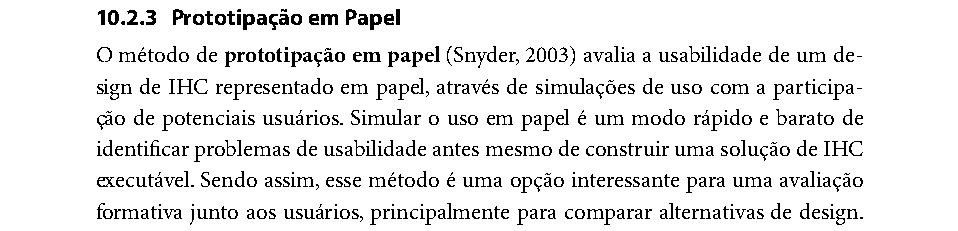

Fonte: BARBOSA; SILVA (2010, p. 358).

As atividades do método seguiram a Tabela 10.7 de Barbosa e Silva, apresentada na Figura 2: preparação, coleta de dados, interpretação, consolidação e relato dos resultados (BARBOSA; SILVA, 2010, cap. 10, seção 10.2.3, p. 359). Ao final de cada sessão, foi feita uma entrevista pós-teste para colher a opinião do participante (BARBOSA; SILVA, 2010, cap. 10, seção 10.2.3, p. 361, 1º parágrafo).

**Figura 2 – Barbosa e Silva (2010), cap. 10, seção 10.2.3, p. 359: Tabela 10.7, atividades do método de prototipação em papel**

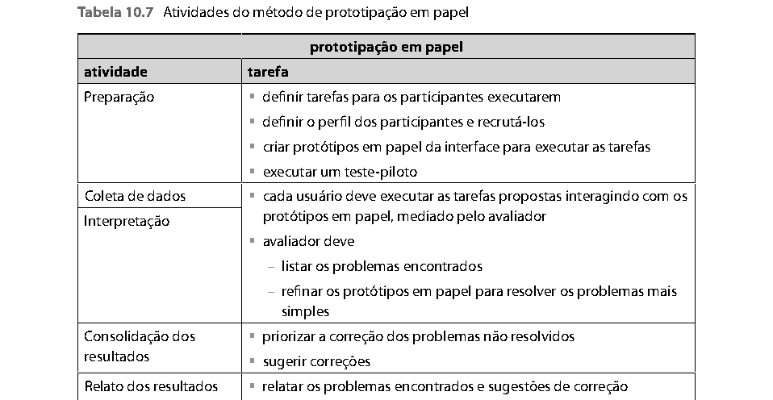

Fonte: BARBOSA; SILVA (2010, p. 359).

Entre uma sessão e outra, os problemas mais simples puderam ser corrigidos no protótipo, aprimorando-o por ciclos de avaliação e reprojeto (BARBOSA; SILVA, 2010, cap. 10, seção 10.2.3, p. 361, 2º parágrafo). Por isso, o relato separa os problemas corrigidos durante os ciclos (seção 1.5) dos que permaneceram ao final das sessões (seção 1.6).

### 1.3. Número e Perfil dos Avaliadores e Participantes

Cada sessão deveria contar com dois avaliadores, já que a coleta de dados nesse método “deve ser realizada por pelo menos dois avaliadores: um responsável por simular o comportamento do sistema e outro por observar a experiência de uso” (BARBOSA; SILVA, 2010, cap. 10, seção 10.2.3, p. 360, 2º parágrafo), conforme a Figura 3. A Tabela 1 resume os avaliadores e os participantes de cada protótipo. Os participantes são identificados apenas por códigos, como prevê o planejamento (GRUPO 03, 2026c, seção 3.5).

**Figura 3 – Barbosa e Silva (2010), cap. 10, seção 10.2.3, p. 360: papéis dos avaliadores na prototipação em papel**

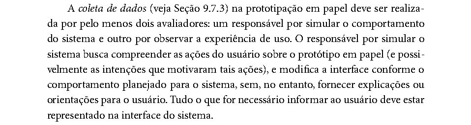

Fonte: BARBOSA; SILVA (2010, p. 360).

**Tabela 1 – Avaliadores e participantes da avaliação dos protótipos de papel**

| Protótipo (autor) | Avaliador que simula o sistema | Observador | Participantes (códigos) | Perfil dos participantes | Data e local das sessões |
| --- | --- | --- | --- | --- | --- |
| Henrique Schneider | Henrique Schneider | Nenhum observador além de Henrique, que foi também o operador (“computador”) (informado pelo autor em 03/11/2026); registros feitos a partir da gravação, como prevê ROSA (2026d, seção 4) | P5 (Sessão 1; o piloto foi feito antes e seus dados foram descartados). Não haverá outras sessões (informado pelo autor em 03/11/2026) | Situação similar à da persona Camila (informado pelo autor em 03/11/2026). Pré-teste feito por Henrique em 03/11/2026, fora da gravação | Sessão 1: 03/11/2026, início às 16h48, duração de 17 min 37 s, laboratório da UnB |
| Alexandre Vilar | — | — | — | — | — |
| João Vitor Tavares | — | — | — | — | — |
| Gabriel Robson | — | — | — | — | — |

Fonte: Elaborado pelos autores (2026).

### 1.4. Protótipos Avaliados e Tarefas Executadas

A Tabela 2 relaciona cada protótipo de papel à tarefa da HTA que ele representa e às tarefas executadas pelos participantes. As seções 1.4.1 a 1.4.4 descrevem os resultados de cada protótipo.

**Tabela 2 – Protótipos de papel avaliados e tarefas executadas**

| Protótipo (autor) | Tarefa da HTA representada | Telas e partes móveis | Tarefas executadas pelos participantes |
| --- | --- | --- | --- |
| Henrique Schneider | Agendar a prova teórica da primeira habilitação com reserva de horário (Fluxo 3; HTA v1.2) | Telas 0, 1, 2, 3, 3B, 4 e 5 e peças soltas: unidades, reserva do dia, confirmação do horário, aviso de horário não selecionado e mensagens curtas (Figuras 4 a 7) | T1 e T3 executadas; T2 e T4 não foram executadas na Sessão 1 e não serão feitas, pois não haverá outras sessões (seção 1.4.1) |
| Alexandre Vilar | — | — | — |
| João Vitor Tavares | Agendar e gerenciar biometria no Portal Detran-DF | Portal Detran-DF; seleção do serviço; local/data/horário/WhatsApp; confirmação; lembrete por WhatsApp; confirmação de presença; reagendamento; cancelamento e mensagens de sucesso | T1 – Agendar biometria; T2 – Confirmar presença; T3 – Reagendar após imprevisto; T4 – Cancelar agendamento |
| Gabriel Robson | — | — | — |

Fonte: Elaborado pelos autores (2026).

#### 1.4.1. Protótipo de Papel — Henrique Schneider

O protótipo de Henrique Schneider representa a tarefa do seu storyboard, agendar a prova teórica da primeira habilitação com reserva de horário (Fluxo 3, persona Camila), na versão revisada da HTA (v1.2, 25/10/2026). Cada tela corresponde a um objetivo da HTA: Tela 0 – serviços do Detran-DF, com o agendamento entre os mais acessados (operação 1.2); Tela 1 – entrada com a conta gov.br e abertura do serviço “Habilitação” (objetivos 1.1 e 1.2); Tela 2 – pré-requisitos (objetivo 2); Tela 3 – escolha da unidade e da data (objetivos 3.1 e 3.2); Tela 3B – escolha do horário, com a quantidade de vagas (objetivo 3.3); Tela 4 – horário reservado, com prazo, valor e botão para copiar a chave PIX (objetivo 4.1); Tela 5 – confirmação “Prova confirmada” (objetivo 5) (GRUPO 03, 2026c, seção 3.8.1).

Os participantes executaram as tarefas T1 (agendar a prova para a data mais próxima, no período da manhã), T2 (encontrar outra opção quando a data escolhida não tem horário), T3 (verificar a confirmação e os documentos) e T4 (recuperar um horário após a reserva expirar) (GRUPO 03, 2026c, seção 3.8.1).

O protótipo foi desenhado à mão pelo autor e tem sete telas, mostradas nas Figuras 4 a 6, além das peças soltas da Figura 7. Em relação ao modelo do planejamento (GRUPO 03, 2026c, seção 3.8.1), três mudanças foram feitas na construção. A escolha do horário passou para uma tela própria, a Tela 3B (“Horários disponíveis”, passo 3 de 3), que lista os horários com a quantidade de vagas e pede confirmação (“Deseja confirmar esse horário?”), com o aviso “Selecione um horário” quando o participante toca em “Reservar” sem escolher. As unidades são escolhidas em tiras soltas (Gama, Asa Norte, Sudoeste e Asa Sul), e a escolha do dia mostra a peça “Reservar horário no dia”, com os botões “Escolher horário” e “Mudei de ideia”. A Tela 4 ganhou o atalho “Voltar para página inicial” e o campo das horas restantes da reserva. Na Sessão 1, a notificação “Prova confirmada” (peça F) não foi usada (informado pelo autor em 03/11/2026), e os avisos de data sem vagas e de reserva expirada (T2 e T4) não foram usados, pois essas tarefas não foram executadas.

**Figura 4 – Protótipo de papel de Henrique Schneider: (a) Tela 0, serviços do Detran-DF; (b) Tela 1, Habilitação · 1ª CNH; (c) Tela 2, antes de agendar**

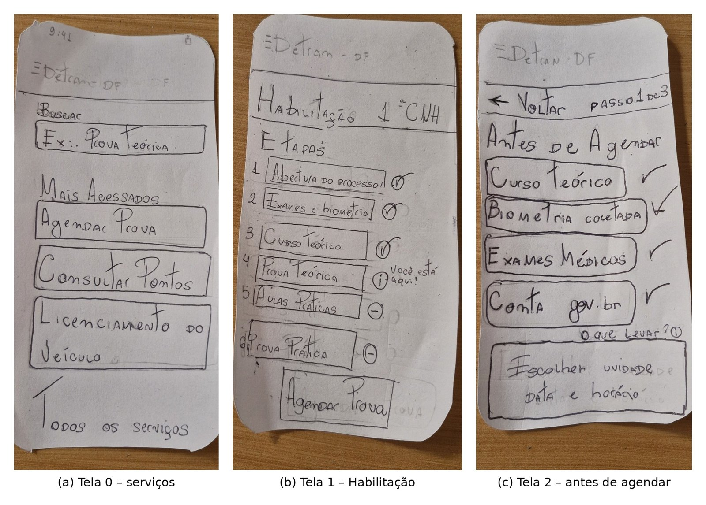

Fonte: elaborado pelo autor (2026).

**Figura 5 – Protótipo de papel de Henrique Schneider: (a) Tela 3, escolha da unidade e da data; (b) Tela 3B, horários disponíveis**

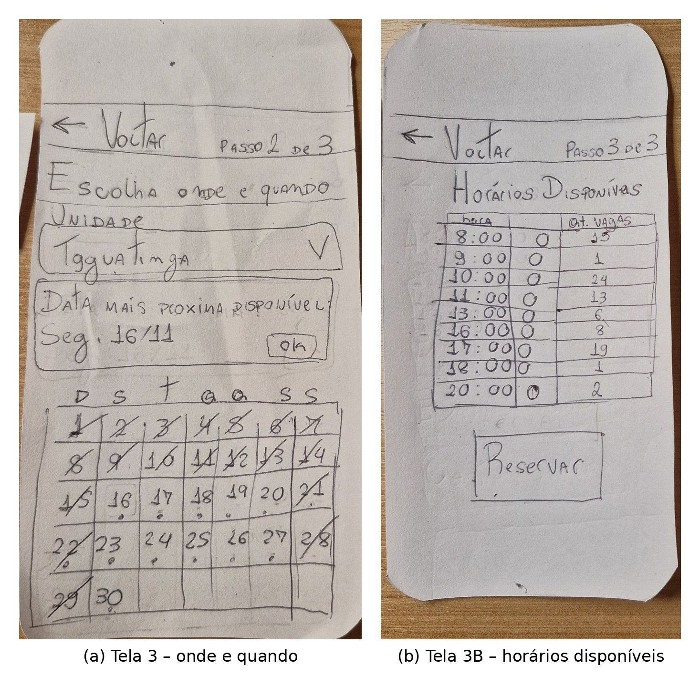

Fonte: elaborado pelo autor (2026).

**Figura 6 – Protótipo de papel de Henrique Schneider: (a) Tela 4, horário reservado; (b) Tela 5, prova confirmada**

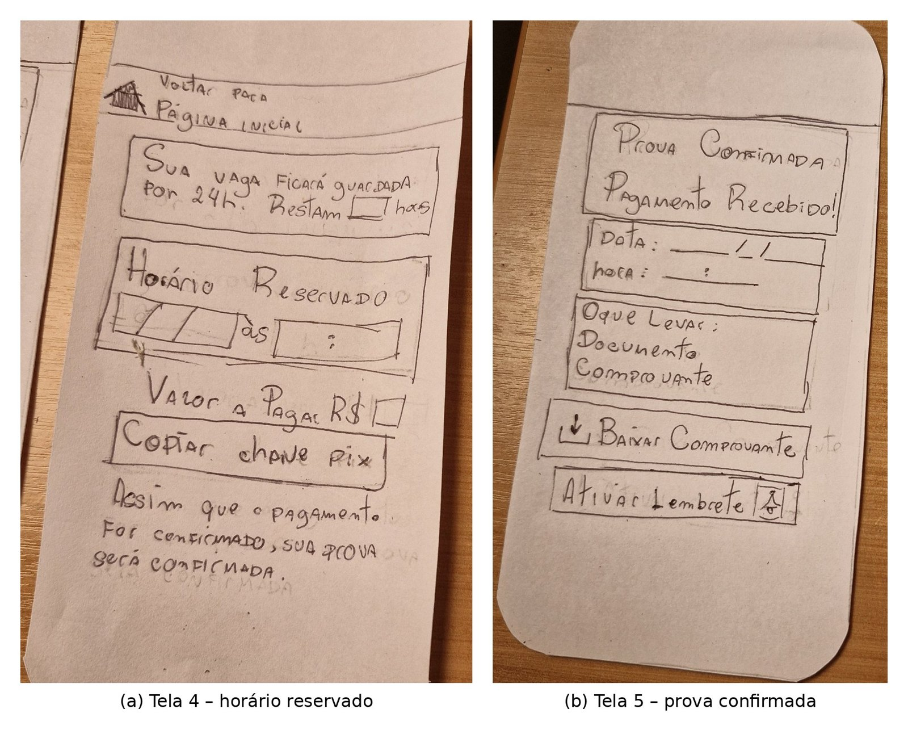

Fonte: elaborado pelo autor (2026).

**Figura 7 – Peças soltas do protótipo de papel de Henrique Schneider: (a) unidades e reserva do dia; (b) confirmação do horário e aviso de horário não selecionado; (c) mensagens curtas**

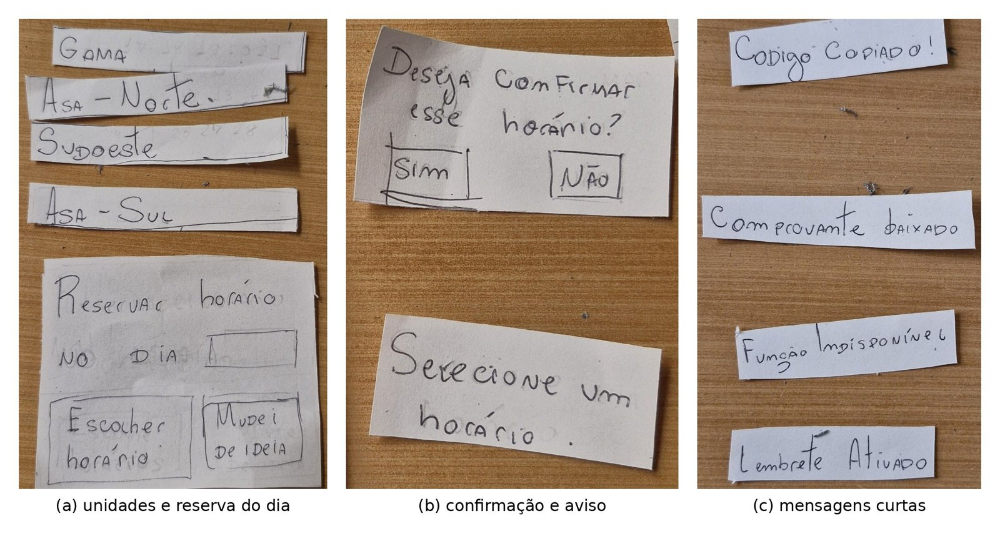

Fonte: elaborado pelo autor (2026).

A Sessão 1 foi realizada em 03/11/2026, no laboratório da UnB, com início às 16h48, e durou 17 min 37 s, abaixo do limite de 30 minutos do planejamento (ROSA, 2026d, seção 4). Participou uma pessoa identificada como P5. O teste piloto foi realizado por Henrique em 03/11/2026, das 14h00 às 14h30 (informado pelo autor em 03/11/2026), antes da sessão, e os dados dele não entram neste relato (BARBOSA; SILVA, 2010, cap. 9, seção 9.7.2, p. 307, 3º parágrafo). Henrique Schneider fez o papel de “computador” e não houve outro observador (informado pelo autor em 03/11/2026); a transcrição (ROSA, 2026e) registra apenas as vozes de Henrique e do participante, e os registros abaixo foram feitos a partir da gravação. O participante aprovou o TCLE, com autorização para gravar áudio, rosto e vídeo; o TCLE não aparece na gravação. O pré-teste foi feito por Henrique em 03/11/2026, fora da gravação (informado pelo autor em 03/11/2026). Não haverá outras sessões (informado pelo autor em 03/11/2026). Link da gravação: <https://youtu.be/S7j1gd70_Is>.

Tarefas. T1 foi concluída: o participante abriu “Agendar prova” na Tela 0, passou pelas Telas 1 e 2, escolheu a unidade e a data mais próxima (16/11), voltou atrás e escolheu o dia 17/11 às 16 h, tocou em “Reservar”, confirmou no pop-up e chegou à Tela 4, onde leu o prazo da reserva (“restam 16 horas”) e copiou a chave Pix. Levou cerca de 3 min 20 s (de 0:22 a 3:40 da gravação). O horário das 16 h foi escolha própria (“eu tenho coisa pra fazer”), de modo que o critério “período da manhã” não foi atendido; o cartão T1 foi entregue ao participante (informado pelo autor em 03/11/2026), mas a instrução falada pediu apenas agendar a prova teórica. T3 foi concluída: depois de Henrique perguntar o que faria após o pagamento, o participante foi em “Todo serviço” e “Agendar prova”, viu a tela “Prova confirmada” com data e horário e baixou o comprovante, em cerca de 35 s (de 3:40 a 4:14). Chegou à confirmação pelo botão de agendar, e não pela notificação (peça F) prevista no roteiro; a peça F não foi usada (informado pelo autor em 03/11/2026). T2 (data sem vagas) e T4 (reserva expirada) não foram executadas: a única referência na gravação é uma hipótese de Henrique sobre a data mais próxima não ser o dia 16 e, como não haverá outras sessões (informado pelo autor em 03/11/2026), não foram avaliadas neste protótipo.

Ajuda e intervenções. Em T1 e T3 o participante não pediu ajuda. Henrique repetiu a instrução (“você pode fazer o que você quiser com a tela”) e conduziu a passagem de T1 para T3 perguntando o que o participante faria depois do Pix. Depois de T3, a conversa virou uma entrevista pós-teste com revisão tela a tela (de 4:14 a 17:36), na qual Henrique explicou que as etapas das Telas 1 e 2 são só marcadores, que o botão “OK” da Tela 3 leva direto à próxima tela, que a seleção do horário é feita nos círculos da Tela 3B e que o pagamento previsto é só por Pix. Essas explicações vão além da orientação de não explicar as telas durante a simulação (BARBOSA; SILVA, 2010, cap. 10, seção 10.2.3, p. 360, 2º parágrafo) e entram nas limitações (seção 1.9).

Entrevista pós-teste. A entrevista não seguiu todas as perguntas do roteiro (ROSA, 2026d, seção 7, etapa 8): não constam as perguntas sobre o prazo de 24 horas, sobre a segurança de a prova estar confirmada e sobre a comparação com o agendamento atual. O participante considerou o fluxo realista (“Acredito que sim. Está bem direcionado”), descreveu o caminho do botão de agendar até o pagamento e disse que só faltava poder consultar o status final do agendamento. Os problemas e as sugestões dele estão nas Tabelas 3 (PC01 e PC02) e 5 (PN01 a PN04); a gravidade, os fatores de usabilidade e as sugestões de correção foram propostos a partir da transcrição e adotados pelo autor em 03/11/2026, por decisão dele, sem confirmação do grupo.

Durante a sessão, foram escritos no protótipo dois botões a partir das sugestões do participante, ambos na Tela 5 e registrados na Tabela 3: “Voltar para página inicial” (PC01) e “Consultar prova” (PC02), conforme consta na gravação (14:58–16:31). Os demais problemas continuam na Tabela 5.

Link do vídeo: [https://youtu.be/sI_3rqIQbCU](https://youtu.be/sI_3rqIQbCU)

#### 1.4.2. Protótipo de Papel — Alexandre Vilar

A parte de Alexandre Vilar nesta seção não foi incorporada à versão 1.8 do documento do grupo. O material publicado pelo integrante está na [página individual](integrantes/alexandre-vilar/prototipo-papel.md). As gravações estão na [página de vídeo](integrantes/alexandre-vilar/video-avaliacao.md).

#### 1.4.3. Protótipo de Papel — João Vitor Tavares

O protótipo de papel de João Vitor Tavares representa a tarefa de agendamento e gerenciamento da biometria no Portal Detran-DF, com base no storyboard e na versão revisada da HTA elaborada na Entrega 5.

O fluxo começa no Portal Detran-DF, onde o usuário localiza o serviço de biometria e informa o posto de atendimento, a data, o horário e um número de telefone com WhatsApp para o recebimento de notificações. Antes da conclusão, o usuário confere os dados e confirma o agendamento.

Após o agendamento, o protótipo representa o recebimento de um lembrete prévio pelo WhatsApp. A partir dessa notificação, o usuário pode confirmar sua presença, reagendar o atendimento para outra data e horário ou cancelar o agendamento, liberando a vaga anteriormente reservada.

O protótipo é composto por telas desenhadas em papel que representam os principais estados da interação, incluindo a página do Portal Detran-DF, a seleção do serviço de biometria, a escolha de local, data e horário, o fornecimento do número de WhatsApp, a confirmação do agendamento, o lembrete enviado ao usuário e os fluxos de confirmação, reagendamento e cancelamento.

**Figura 8 – Protótipo de papel do fluxo de agendamento de biometria no Portal Detran-DF**

Fonte: elaborado pelo autor (2026)

**Figura 9 – Protótipo de papel do lembrete e gerenciamento do agendamento de biometria pelo WhatsApp**

Fonte: elaborado pelo autor (2026).

Foram definidas as seguintes tarefas para a avaliação:

- T1 — realizar o agendamento da biometria;
- T2 — confirmar a presença a partir do lembrete recebido pelo WhatsApp;
- T3 — diante de um imprevisto, reagendar o atendimento para uma nova data e horário;
- T4 — cancelar o agendamento e verificar a confirmação do cancelamento.

Os resultados da avaliação, incluindo as tarefas concluídas, dificuldades observadas, correções realizadas no protótipo e opinião dos participantes, serão registrados após a realização das sessões.

Link do vídeo: [https://youtu.be/8QlxHni0lzY](https://youtu.be/8QlxHni0lzY)

#### 1.4.4. Protótipo de Papel — Gabriel Robson

A parte de Gabriel Robson nesta seção não foi incorporada à versão 1.8 do documento do grupo. O material publicado pelo integrante está na [página individual](integrantes/gabriel-robson/prototipo-papel.md). As gravações estão na [página de vídeo](integrantes/gabriel-robson/video-avaliacao.md).

### 1.5. Lista de Problemas Corrigidos durante os Ciclos de Avaliação

Cada problema é descrito pelo local em que ocorreu e pelos fatores de usabilidade prejudicados. Os fatores considerados são facilidade de aprendizado, facilidade de recordação, eficiência, segurança no uso e satisfação do usuário (NIELSEN, 1993 apud BARBOSA; SILVA, 2010, cap. 2, seção 2.2.1, p. 29), conforme a Figura 10. A Tabela 3 registra os problemas corrigidos no protótipo entre uma sessão e outra, no modelo definido na Entrega 5 (GRUPO 03, 2026c, Tabela 16).

**Figura 10 – Barbosa e Silva (2010), cap. 2, seção 2.2.1, p. 29: fatores de usabilidade**

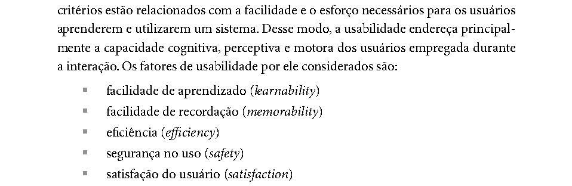

Fonte: BARBOSA; SILVA (2010, p. 29).

**Tabela 3 – Problemas corrigidos durante os ciclos de avaliação e reprojeto**

| ID | Protótipo | Local (tela e elemento) | Fatores de usabilidade prejudicados | Descrição e justificativa | Correção realizada no protótipo | Voltou a ocorrer após a correção? |
| --- | --- | --- | --- | --- | --- | --- |
| PC01 | Henrique Schneider | Tela 5 (Prova confirmada) | Eficiência; satisfação do usuário | A tela não tinha opção de voltar. O participante apontou a falta e disse que voltaria para a página inicial. | Botão “Voltar para página inicial” escrito no papel durante a sessão. | Não verificado: a correção foi feita na própria sessão e a gravação não registra nova execução depois dela |
| PC02 | Henrique Schneider | Tela 5 (Prova confirmada) | Eficiência; facilidade de aprendizado; satisfação do usuário | Depois de pagar, não havia como consultar a prova já agendada. O participante já tinha achado “meio redundante” usar “Agendar prova” para ver a confirmação (4:14–5:02), pediu um botão para consultar a prova (14:58–16:31) e, ao fim da entrevista, disse que só faltava poder consultar o status (16:36–17:36). | Botão “Consultar prova” escrito no papel durante a sessão (14:58–16:31). | Não verificado: a correção foi feita na própria sessão e a gravação não registra nova execução depois dela |

Fonte: Elaborado pelos autores com base em Barbosa e Silva (2010, cap. 10, p. 361).

### 1.6. Lista de Problemas Não Corrigidos e Prioridade de Correção

Os problemas que permaneceram ao final das sessões foram priorizados “com base na gravidade (o quanto prejudicaram a interação) e frequência em que ocorreram” (BARBOSA; SILVA, 2010, cap. 10, seção 10.2.3, p. 361, 4º parágrafo), conforme a Figura 11. A gravidade segue a escala de severidade de Nielsen apresentada por Barbosa e Silva, reproduzida na Tabela 4 (BARBOSA; SILVA, 2010, cap. 10, pp. 319–320), conforme a Figura 12.

**Figura 11 – Barbosa e Silva (2010), cap. 10, seção 10.2.3, p. 361: ciclos de avaliação e priorização dos problemas**

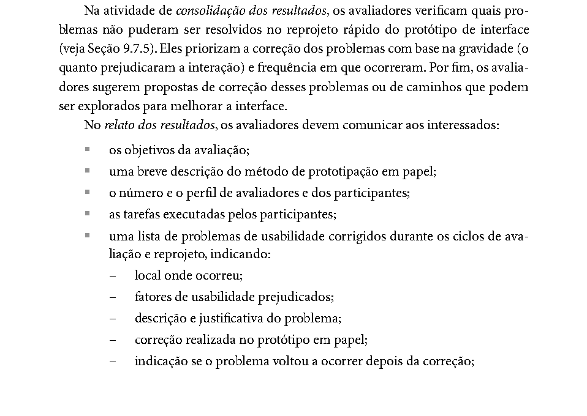

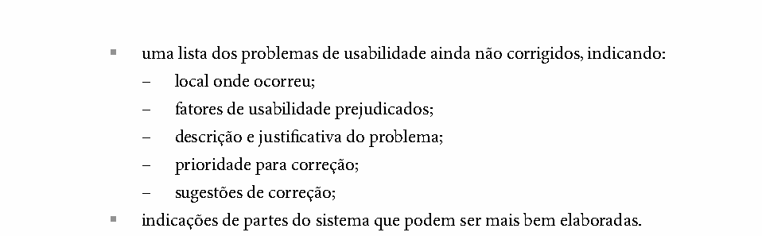

Fonte: BARBOSA; SILVA (2010, pp. 361–362).

**Tabela 4 – Escala de severidade dos problemas**

| Grau | Classificação | Significado |
| --- | --- | --- |
| 1 | Cosmético | Não precisa ser consertado, a menos que haja tempo no cronograma do projeto. |
| 2 | Pequeno | O conserto pode receber baixa prioridade. |
| 3 | Grande | Importante de ser consertado; deve receber alta prioridade. |
| 4 | Catastrófico | Extremamente importante de consertar; se mantido, provavelmente impedirá o usuário de realizar suas tarefas. |

Fonte: Adaptado de Barbosa e Silva (2010, cap. 10, p. 320), com base em Nielsen (1994).

**Figura 12 – Barbosa e Silva (2010), cap. 10, pp. 319–320: escala de severidade de Nielsen**

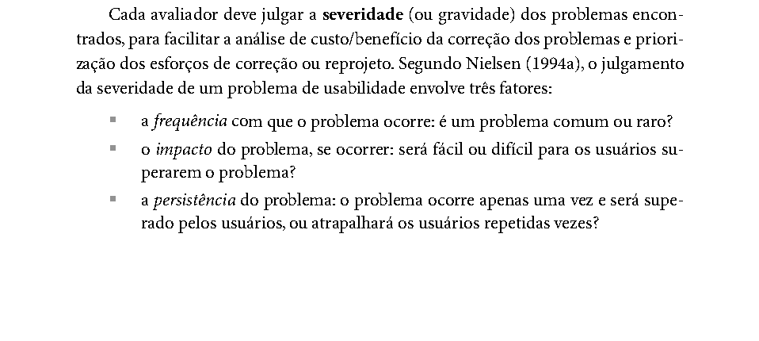

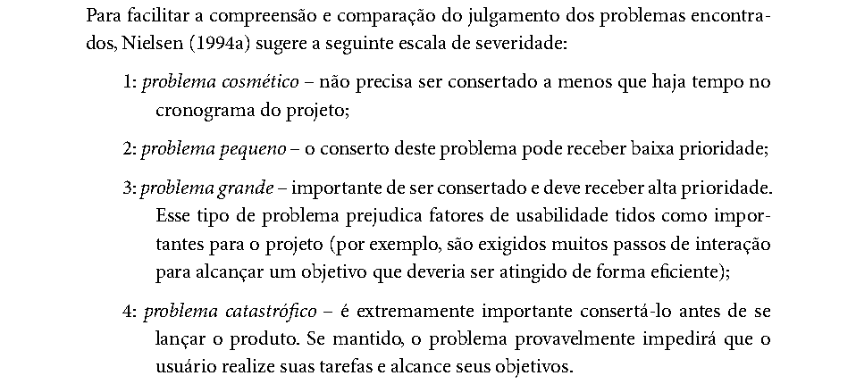

Fonte: BARBOSA; SILVA (2010, pp. 319–320).

A Tabela 5 apresenta os problemas não corrigidos, ordenados por gravidade e frequência, no modelo definido na Entrega 5 (GRUPO 03, 2026c, Tabela 17).

**Tabela 5 – Problemas não corrigidos e prioridade de correção**

| ID | Protótipo | Local (tela e elemento) | Fatores de usabilidade prejudicados | Descrição e justificativa | Prioridade (gravidade 1–4 e frequência) | Sugestão de correção |
| --- | --- | --- | --- | --- | --- | --- |
| PN01 | Henrique Schneider | Telas 1 e 2 (lista de etapas e itens de “antes de agendar”) | Facilidade de aprendizado; satisfação do usuário | As etapas parecem botões, mas são só marcadores: o participante perguntou se podia consultá-las e, na Tela 2, se eram “etapas” ou “botões”. Henrique explicou que são marcadores. | Gravidade 2 (pequeno); frequência 1 de 1 participante (classificação adotada pelo autor) | Diferenciar visualmente marcadores e botões, ou usar caixas expansíveis (drop-down) com os detalhes de cada etapa, mantendo as seis visíveis (sugestão do participante). |
| PN02 | Henrique Schneider | Tela 3 (botão “OK” da data mais próxima) | Facilidade de aprendizado; eficiência | O botão é pequeno e não parece clicável: o participante não entendeu que, ao tocar nele, iria direto para a próxima tela, e achou que teria de ver a data mais próxima e tocar no calendário. | Gravidade 2 (pequeno); frequência 1 de 1 participante (classificação adotada pelo autor) | Tornar o botão maior e com aparência de ação (sugestão do participante). |
| PN03 | Henrique Schneider | Tela 3 (datas indisponíveis, riscadas) | Facilidade de aprendizado; satisfação do usuário | Ao tocar numa data riscada não acontece nada. O participante achou subentendido que não pode clicar, mas disse que, “pra qualquer caso”, seria bom mostrar que a data não está disponível. | Gravidade 1 (cosmético); frequência 1 de 1 participante (classificação adotada pelo autor) | Mostrar uma mensagem curta de “data não disponível” ao tocar na data (sugestão do participante). |
| PN04 | Henrique Schneider | Tela 3B (horários e vagas) | Facilidade de aprendizado; eficiência | A lista de horários com vagas parece uma tabela: na revisão tela a tela, o participante ficou confuso sobre como escolher o horário e achou que precisaria tocar na linha; Henrique explicou que a escolha é nos círculos. Em T1 ele escolheu o horário das 16 h sem pedir ajuda. | Gravidade 2 (pequeno); frequência 1 de 1 participante (classificação adotada pelo autor) | Trocar os círculos por botões ou rótulos selecionáveis para cada horário (sugestão do participante). |

Fonte: Elaborado pelos autores com base em Barbosa e Silva (2010, cap. 10, p. 362).

### 1.7. Partes do Sistema que Podem Ser Mais Bem Elaboradas

O relato da prototipação em papel também deve indicar as partes do sistema que podem ser mais bem elaboradas (BARBOSA; SILVA, 2010, cap. 10, seção 10.2.3, p. 362). A Tabela 6 registra essas partes e a recomendação correspondente para o protótipo de alta fidelidade, que será construído a partir delas (Capítulo 2).

**Tabela 6 – Partes a serem mais bem elaboradas no protótipo de alta fidelidade**

| Protótipo | Parte do sistema | Problemas relacionados (Tabelas 3 e 5) | Recomendação para o protótipo de alta fidelidade |
| --- | --- | --- | --- |
| Henrique Schneider | Telas 1 e 2 (etapas), Tela 3 (data mais próxima e datas indisponíveis), Tela 3B (seleção de horário) e Tela 5 (botões de voltar e de consultar prova) | PN01 a PN04, PC01 e PC02 | Diferenciar marcadores e botões; dar mais destaque ao botão da data mais próxima e avisar quando a data está indisponível; trocar os círculos da Tela 3B por botões selecionáveis; manter na Tela 5 os botões “Voltar para página inicial” e “Consultar prova”, escritos na sessão; avaliar também separar, na Tela 0, um item “Prova” com “Agendar prova” e “Consultar prova” (sugestão do participante, ainda não testada) |
| Alexandre Vilar | — | — | — |
| João Vitor Tavares | — | — | — |
| Gabriel Robson | — | — | — |

Fonte: Elaborado pelos autores (2026).

### 1.8. Interpretação e Análise dos Dados

Para o protótipo de Henrique Schneider (P5), o participante abriu “Agendar prova” na Tela 0 logo no início de T1, sem hesitar, o que é um indício de que o destaque do serviço atendeu ao problema 04 do storyboard (serviço difícil de encontrar) (ROSA, 2026d, Tabela 2); em contrapartida, estranhou que o mesmo botão sirva para agendar e consultar a prova (PC02, Tabela 3). Com um único participante, são apenas indícios.

### 1.9. Limitações da Avaliação

A validade ecológica da avaliação é limitada, pois o papel não reproduz o uso do portal no celular ou no computador, limitação já prevista no planejamento (GRUPO 03, 2026c, seção 3.6). Como o número de participantes por protótipo é pequeno, os resultados são indícios sobre a qualidade de uso, e não resultados estatisticamente significativos (BARBOSA; SILVA, 2010, cap. 9, seção 9.7.2, p. 305, 3º parágrafo). Na sessão de Henrique Schneider (seção 1.4.1), houve um único participante, sem outro observador além do operador (Henrique), com o pré-teste fora da gravação e sem outras sessões; a entrevista pós-teste virou uma revisão tela a tela com explicações do avaliador; as tarefas T2 e T4 não foram executadas; e a instrução falada não trouxe as restrições do cartão T1.

## 2. Planejamento da Avaliação do Protótipo de Alta Fidelidade (Framework DECIDE)

O protótipo de alta fidelidade é construído a partir das correções e recomendações do Capítulo 1. Segundo Preece, Rogers e Sharp, “A prototipagem de alta-fidelidade utiliza materiais que você espera que estejam no produto final e realiza um protótipo que se parece muito mais com algo acabado” (PREECE; ROGERS; SHARP, 2005, cap. 8, seção 8.2.4, p. 265, 1º parágrafo da seção), conforme a Figura 13. Os mesmos autores observam que “A prototipação de alta-fidelidade é útil para vender idéias a pessoas e para testar questões técnicas” e listam problemas desse tipo de protótipo, como o tempo de construção e a tendência dos avaliadores a comentar aspectos superficiais em vez do conteúdo (PREECE; ROGERS; SHARP, 2005, cap. 8, seção 8.2.4, pp. 265–266).

**Figura 13 – Preece, Rogers e Sharp (2005), cap. 8, seção 8.2.4, pp. 265–266: prototipação de alta fidelidade**

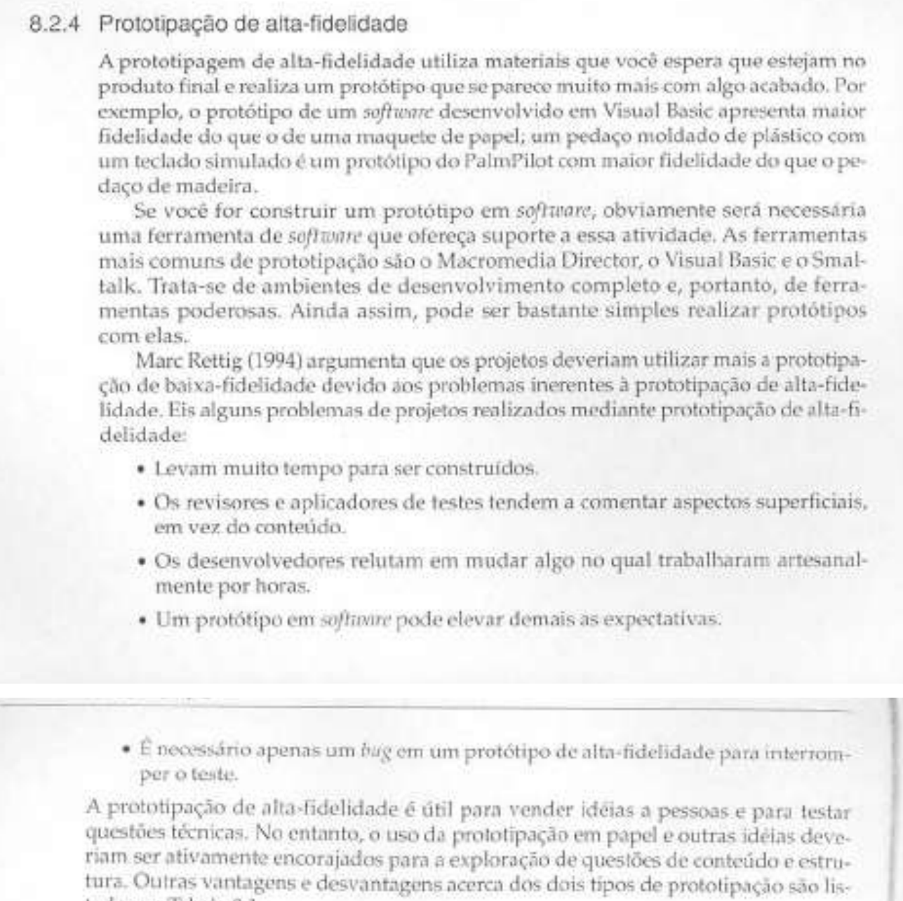

Fonte: PREECE; ROGERS; SHARP (2005, pp. 265–266).

**Autor do item de conteúdo:** Henrique Schneider (redação assistida por Claude, IA generativa)

A Tabela 8.1 dos autores, apresentada na Figura 14, compara os protótipos de baixa e de alta fidelidade e aponta, entre as vantagens do segundo, ser totalmente interativo, ter o uso conduzido pelo usuário e servir para exploração e teste, enquanto o protótipo de baixa fidelidade tem “utilidade limitada para testes de usabilidade” (RUDD et al., 1995 apud PREECE; ROGERS; SHARP, 2005, cap. 8, seção 8.2.4, p. 266, Tabela 8.1). Por isso, nesta etapa o grupo passa da simulação em papel para um teste de usabilidade com o protótipo interativo.

**Figura 14 – Preece, Rogers e Sharp (2005), cap. 8, p. 266: Tabela 8.1, eficácia relativa de protótipos de baixa e de alta fidelidade**

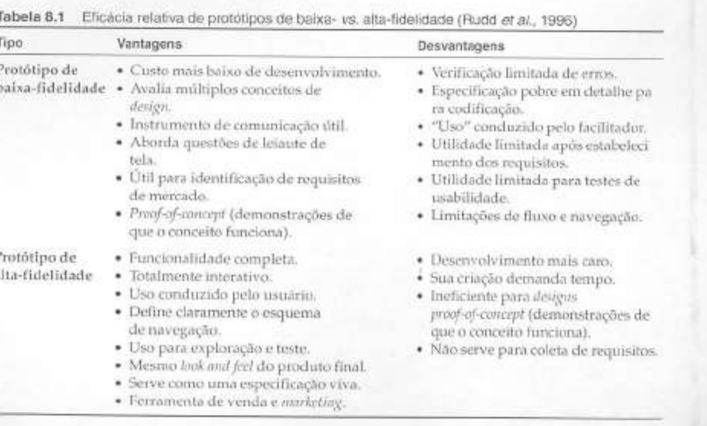

Fonte: PREECE; ROGERS; SHARP (2005, p. 266).

O planejamento segue o framework DECIDE, de Sharp, Rogers e Preece, apresentado por Barbosa e Silva (2010, cap. 9, seção 9.8, pp. 312–313), conforme a Figura 15, a mesma estrutura usada nos planejamentos das Entregas 4 e 5. As seis atividades do framework estão descritas nas seções 2.1 a 2.6.

**Figura 15 – Barbosa e Silva (2010), cap. 9, seção 9.8, pp. 312–313: atividades do framework DECIDE**

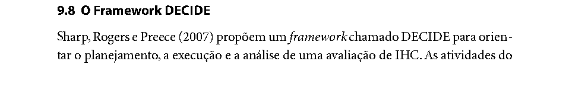

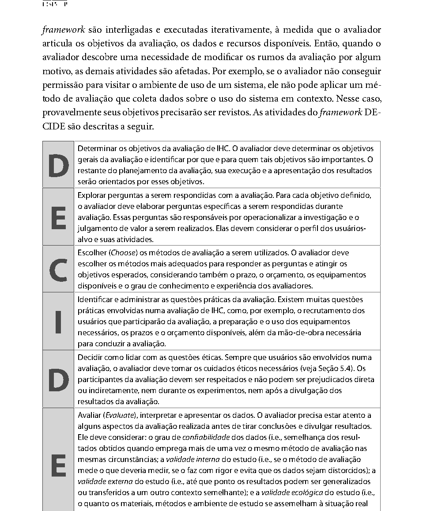

Fonte: BARBOSA; SILVA (2010, pp. 312–313).

### 2.1. D — Determinar os Objetivos

A avaliação do protótipo de alta fidelidade tem três objetivos:

- verificar em que grau o protótipo atinge as metas de usabilidade definidas na Entrega 3 (eficácia, eficiência, segurança no uso, facilidade de aprendizado e facilidade de recordação) (GRUPO 03, 2026b);
- identificar os problemas de usabilidade que ainda ocorrem quando a interação é conduzida pelo próprio usuário, sem um avaliador simulando o sistema;
- verificar se as correções feitas a partir da avaliação dos protótipos de papel (Tabelas 3, 5 e 6) resolveram os problemas encontrados.

Esses objetivos determinam o que será medido, pois, segundo Barbosa e Silva, “Os objetivos da avaliação determinam quais critérios de usabilidade devem ser medidos” (BARBOSA; SILVA, 2010, cap. 10, seção 10.2.1, p. 341, 1º parágrafo da seção).

### 2.2. E — Explorar as Questões de Avaliação

Cada objetivo foi desdobrado em questões associadas a um dado mensurável, como recomendam Barbosa e Silva para o teste de usabilidade (BARBOSA; SILVA, 2010, cap. 10, seção 10.2.1, p. 341, 1º parágrafo da seção). As questões estão na Tabela 7.

**Tabela 7 – Questões de avaliação do protótipo de alta fidelidade**

| Objetivo | Questão | Dado coletado | Meta de usabilidade relacionada |
| --- | --- | --- | --- |
| Verificar as metas | Quantos participantes concluem cada tarefa sem ajuda? | Grau de sucesso por tarefa | Eficácia |
| Verificar as metas | Quanto tempo e quantos passos cada tarefa exige? | Tempo de execução; nº de passos fora do caminho previsto na HTA | Eficiência |
| Verificar as metas | Quantos erros ocorrem e o participante consegue se recuperar deles? | Nº e tipo de erros; recuperação sem ajuda | Segurança no uso |
| Verificar as metas | Quantas vezes o participante pede ajuda ou hesita na primeira execução? | Pedidos de ajuda; pausas observadas | Facilidade de aprendizado |
| Identificar problemas | Em quais telas e elementos o participante erra, hesita ou comenta dificuldade? | Anotações do observador; gravação da tela; comentários | — |
| Validar as correções | Os problemas das Tabelas 3 e 5 voltam a ocorrer no protótipo de alta fidelidade? | Ocorrência dos problemas por ID | — |
| Satisfação | Qual a opinião do participante sobre a experiência de uso? | Entrevista pós-teste | Satisfação do usuário |

Fonte: Elaborado pelos autores com base em Barbosa e Silva (2010, cap. 10, pp. 341–342) e nas metas de usabilidade do grupo (GRUPO 03, 2026b).

### 2.3. C — Escolher o Método de Avaliação

O método escolhido é o teste de usabilidade, que “visa a avaliar a usabilidade de um sistema interativo a partir de experiências de uso dos seus usuários-alvo” (RUBIN, 1994; RUBIN; CHISNELL, 2008 apud BARBOSA; SILVA, 2010, cap. 10, seção 10.2.1, p. 341, 1º parágrafo da seção), conforme a Figura 16. O método é adequado aos objetivos da seção 2.1 porque mede o desempenho dos participantes nas tarefas e permite verificar se as metas de usabilidade foram atingidas.

**Figura 16 – Barbosa e Silva (2010), cap. 10, seção 10.2.1, p. 341: teste de usabilidade**

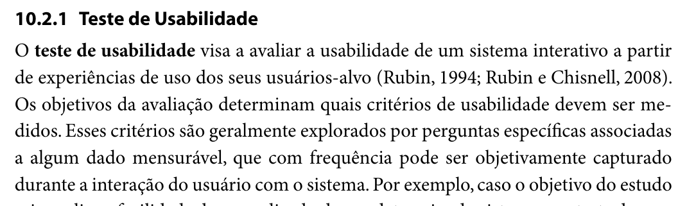

Fonte: BARBOSA; SILVA (2010, p. 341).

**Autor do item de conteúdo:** Henrique Schneider (redação assistida por Claude, IA generativa)

As atividades do teste de usabilidade estão na Tabela 10.4 de Barbosa e Silva, apresentada na Figura 17: preparação, coleta de dados, interpretação, consolidação e relato dos resultados (BARBOSA; SILVA, 2010, cap. 10, seção 10.2.1, p. 342). “A coleta de dados inclui o questionário pré-teste, a sessão de observação e a entrevista pós-teste” (BARBOSA; SILVA, 2010, cap. 10, seção 10.2.1, p. 342, 2º parágrafo após a Tabela 10.4). Em cada tarefa serão medidos o grau de sucesso, o total e o tipo de erros, o tempo de execução e os pedidos de ajuda, além da satisfação do participante (BARBOSA; SILVA, 2010, cap. 10, seção 10.2.1, p. 342).

**Figura 17 – Barbosa e Silva (2010), cap. 10, seção 10.2.1, p. 342: Tabela 10.4, atividades do teste de usabilidade, e coleta de dados**

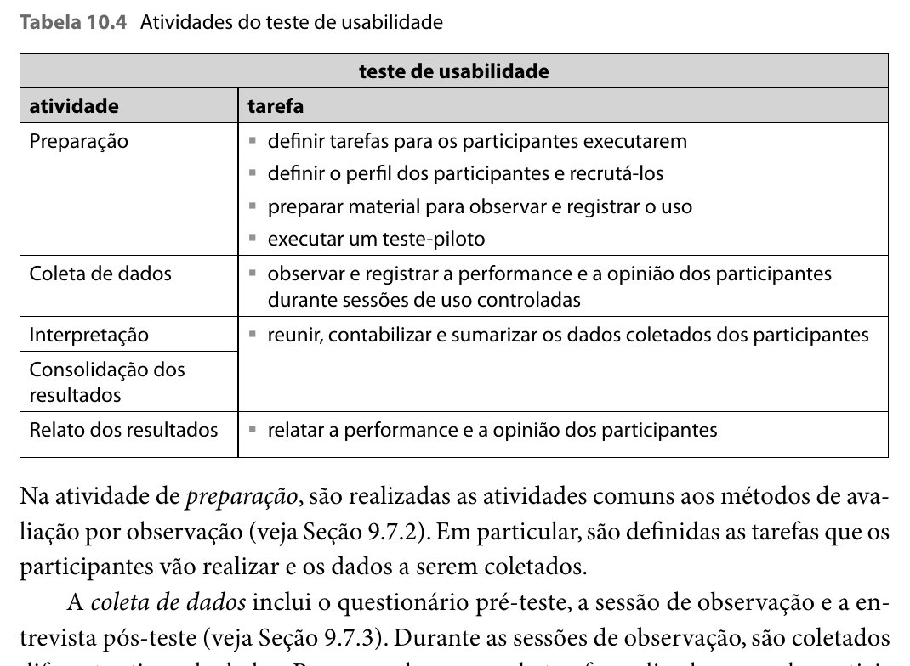

Fonte: BARBOSA; SILVA (2010, p. 342).

O Plano de Ensino também indica para esta etapa o “Cap. 09 - Teste de usabilidade - Avaliação e projeto no design de interfaces” e a respectiva lista de exercícios (SALES, 2026, p. 5). Esse capítulo não foi consultado nesta versão do relatório.

### 2.4. I — Identificar e Administrar as Questões Práticas

- Papéis: cada sessão terá dois avaliadores, um que conduz a sessão junto ao participante e um observador que registra os acontecimentos. Barbosa e Silva afirmam que “É recomendável que pelo menos dois avaliadores trabalhem na coleta de dados” (BARBOSA; SILVA, 2010, cap. 9, seção 9.7.3, p. 309, 5º parágrafo), conforme a Figura 18.
- Participantes: pelo menos dois participantes por protótipo, com o perfil da persona da tarefa (seção 2.8), preferencialmente diferentes dos participantes das avaliações anteriores, para que o conhecimento prévio das telas não influencie o desempenho medido.
- Local e modalidade: sessões presenciais no campus UnB Gama (FCTE) ou em local escolhido pelo participante, com o protótipo aberto em computador ou celular. Não estão previstas sessões remotas.
- Duração: até 30 minutos por sessão, incluindo TCLE, questionário pré-teste, tarefas e entrevista pós-teste, mantendo cada tarefa bem abaixo do limite de 20 minutos indicado por Barbosa e Silva (2010, cap. 9, seção 9.7.2, p. 306).
- Equipamentos e materiais: protótipo interativo (ferramenta a definir no início da construção, em 07/11/2026), computador ou celular, cenários das tarefas impressos, TCLE, roteiro do questionário pré-teste e da entrevista pós-teste, cronômetro e gravação da tela e do áudio somente com autorização.
- Orçamento: sem custo além da impressão dos materiais; serão usadas ferramentas gratuitas.
- Pessoal: os quatro integrantes, cada um responsável pela avaliação do seu protótipo e atuando como observador na avaliação de outro integrante (Tabela 9).

**Figura 18 – Barbosa e Silva (2010), cap. 9, seção 9.7.3, p. 309: avaliadores na coleta de dados**

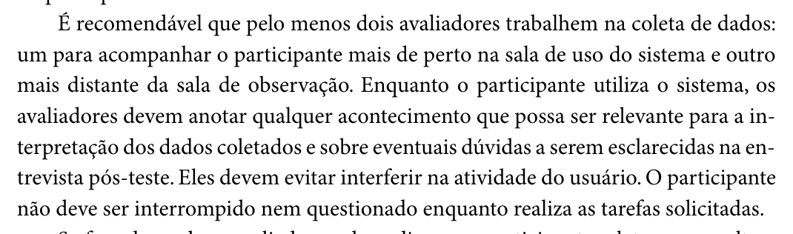

Fonte: BARBOSA; SILVA (2010, p. 309).

A Tabela 8 apresenta o cronograma geral previsto. As datas partem do cronograma da Entrega 1, que previa a execução da avaliação entre 05/11 e 08/11, a tabulação dos dados entre 09/11 e 10/11 e o relato entre 11/11 e 13/11 (GRUPO 03, 2026a, seção 4.13, p. 9), e do prazo da Entrega 7, em 15/11/2026 (SALES, 2026, p. 5).

**Tabela 8 – Cronograma geral da avaliação do protótipo de alta fidelidade**

| Atividade | Início | Fim | Responsável | Local |
| --- | --- | --- | --- | --- |
| Construção dos protótipos de alta fidelidade | — | — | Cada integrante | Remoto |
| Teste piloto | — | — | Cada integrante | — |
| Sessões com participantes | 05/11/2026 | 08/11/2026 | Cada integrante, com um observador | UnB Gama (FCTE) ou local do participante |
| Interpretação e consolidação dos resultados | 09/11/2026 | 10/11/2026 | — | Remoto |
| Relato dos resultados e publicação no GitHub Pages | 11/11/2026 | 15/11/2026 | — | Remoto |

Fonte: Elaborado pelos autores (2026), com base no cronograma da Entrega 1 (GRUPO 03, 2026a, p. 9) e no prazo da Entrega 7 (SALES, 2026, p. 5).

### 2.5. D — Decidir como Lidar com as Questões Éticas

A avaliação seguirá a diretriz do framework DECIDE de que “Os participantes da avaliação devem ser respeitados e não podem ser prejudicados direta ou indiretamente, nem durante os experimentos, nem após a divulgação dos resultados da avaliação” (BARBOSA; SILVA, 2010, cap. 9, seção 9.8, p. 313, quadro do framework DECIDE). Para isso:

- cada participante lerá e assinará o TCLE antes da sessão, ficando com uma via, como recomendam Barbosa e Silva (2010, cap. 5, seção 5.4, p. 141, 1º parágrafo), conforme a Figura 20;
- a gravação da tela e do áudio só será feita com autorização expressa do participante;
- os participantes serão identificados por códigos no relato, sem nome ou dado pessoal, e o protótipo não usará dados reais de CPF ou da conta gov.br;
- o participante não será interrompido durante as tarefas, mas os avaliadores poderão sugerir que ele passe para a próxima tarefa se demonstrar não ter condições de concluí-la ou passar por constrangimento, e ele poderá pausar sempre que quiser (BARBOSA; SILVA, 2010, cap. 9, seção 9.7.3, p. 310, 2º parágrafo), conforme a Figura 19.

**Figura 19 – Barbosa e Silva (2010), cap. 9, seção 9.7.3, p. 310: intervenção do avaliador e pausas**

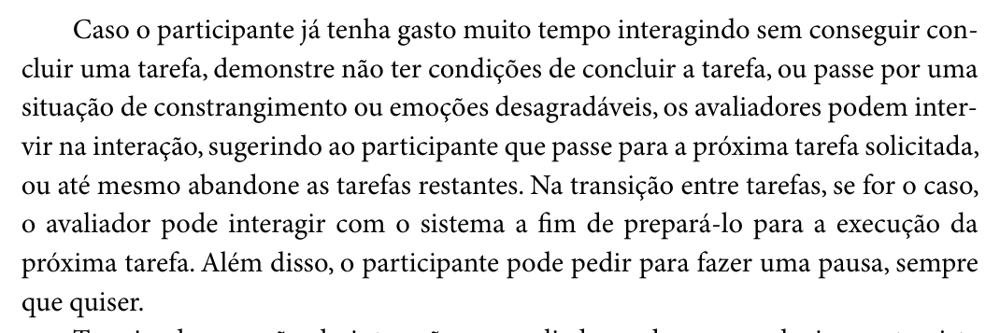

Fonte: BARBOSA; SILVA (2010, p. 310).

**Figura 20 – Barbosa e Silva (2010), cap. 5, seção 5.4, p. 141: termo de consentimento e conforto dos participantes**

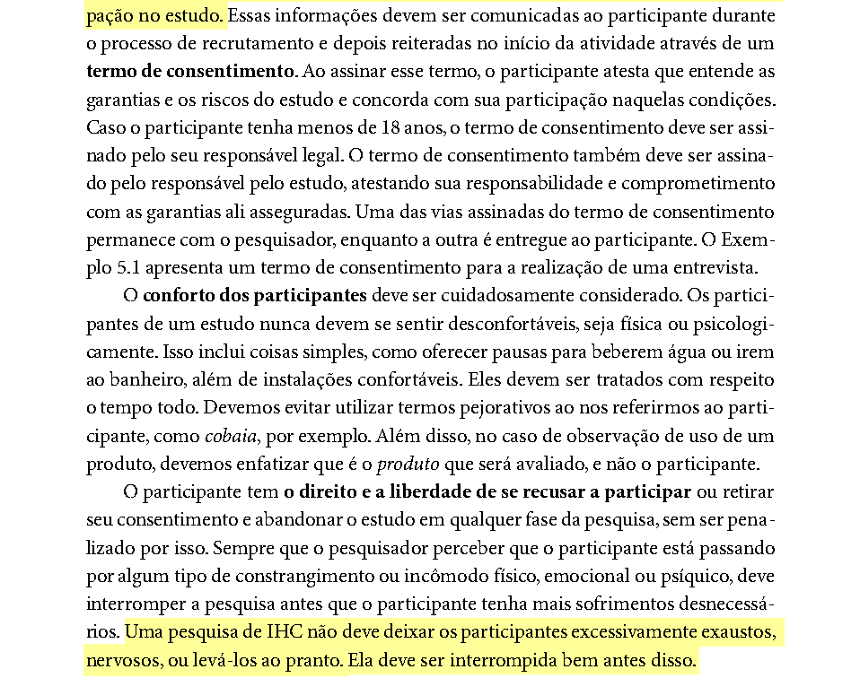

Fonte: BARBOSA; SILVA (2010, p. 141).

### 2.6. E — Avaliar, Interpretar e Apresentar os Dados

Os dados de cada participante serão analisados primeiro individualmente (análise intrassujeito) e depois em conjunto, buscando recorrências (análise intersujeito) (BARBOSA; SILVA, 2010, cap. 9, seções 9.7.4 e 9.7.5, pp. 310–311). As medições serão resumidas em tabelas, com médias e porcentagens, e comparadas às metas de usabilidade. Barbosa e Silva exemplificam que, para uma meta de tempo, o teste permite avaliar o grau em que ela foi atingida “através do número de usuários que concluíram a tarefa dentro do tempo desejado, do tempo médio despendido por eles e do desvio padrão correspondente” (BARBOSA; SILVA, 2010, cap. 10, seção 10.2.1, p. 342, 3º parágrafo após a Tabela 10.4), conforme a Figura 21.

**Figura 21 – Barbosa e Silva (2010), cap. 10, seção 10.2.1, p. 342: interpretação dos dados e verificação das metas de usabilidade**

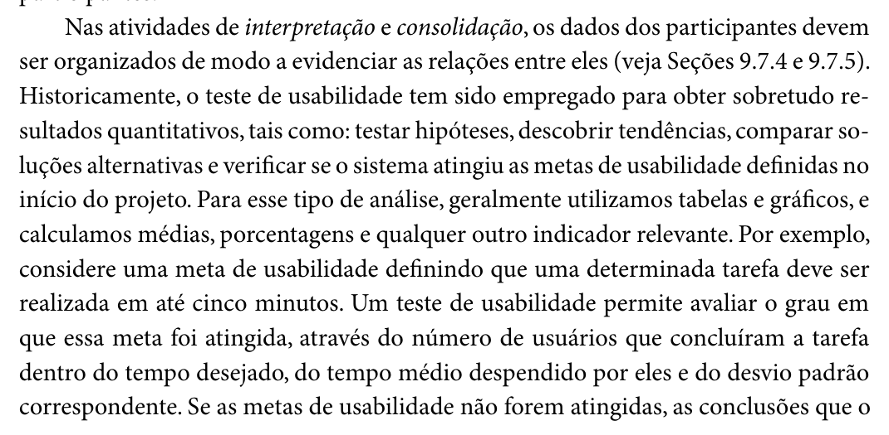

Fonte: BARBOSA; SILVA (2010, p. 342).

Além dos números, cada problema observado será interpretado a partir do conjunto de registros (anotações, gravação e comentários) para explicar suas causas e justificar as recomendações de reprojeto (BARBOSA; SILVA, 2010, cap. 10, seção 10.2.1, p. 343, 2º parágrafo). Antes de tirar conclusões, o grupo considerará a confiabilidade dos dados e as validades interna, externa e ecológica do estudo, como orienta a última atividade do framework DECIDE (BARBOSA; SILVA, 2010, cap. 9, seção 9.8, p. 313).

### 2.7. Teste Piloto

Cada integrante fará um teste piloto antes das sessões definitivas, com uma pessoa que não participou do planejamento. O objetivo do piloto, segundo Barbosa e Silva, “é avaliar o próprio planejamento, e analisar se a avaliação, tal como planejada, produz os dados necessários para responder a questões e objetivos do estudo” (BARBOSA; SILVA, 2010, cap. 9, seção 9.7.2, p. 307, 2º parágrafo), conforme a Figura 22. O piloto verificará a clareza dos cenários, o tempo de cada tarefa, o funcionamento do protótipo e da gravação. Os resultados do piloto não serão apresentados no relato da avaliação, pois esses dados devem ser descartados (BARBOSA; SILVA, 2010, cap. 9, seção 9.7.2, p. 307, 3º parágrafo). A data do teste piloto de cada integrante está na Tabela 9.

**Figura 22 – Barbosa e Silva (2010), cap. 9, seção 9.7.2, p. 307: teste piloto**

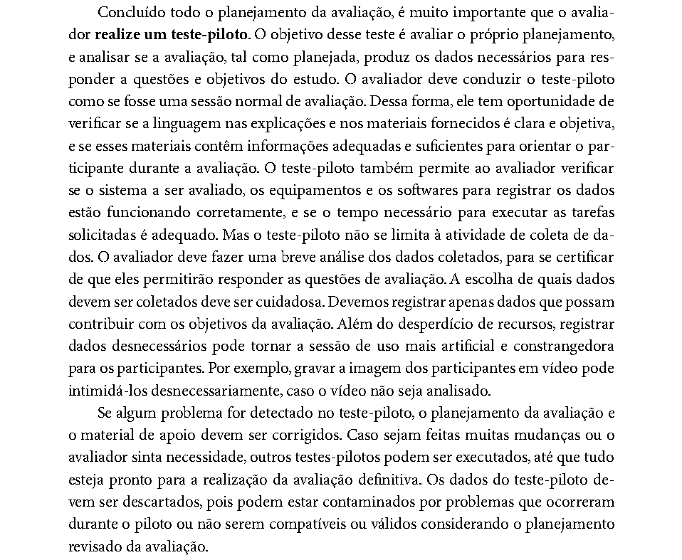

Fonte: BARBOSA; SILVA (2010, p. 307).

**Autor do item de conteúdo:** Henrique Schneider (redação assistida por Claude, IA generativa)

### 2.8. Cronograma da Avaliação do Protótipo de Alta Fidelidade por Integrante

Cada integrante planeja a avaliação do seu próprio protótipo de alta fidelidade e registra na Tabela 9 as tarefas, as datas, o local e o horário das suas sessões, acrescentando linhas à tabela. As seções 2.8.1 a 2.8.4 trazem a parte de cada integrante.

**Tabela 9 – Cronograma da avaliação do protótipo de alta fidelidade por integrante**

| Tarefa | Integrante | Início | Fim | Local e horário |
| --- | --- | --- | --- | --- |
| Construção do protótipo de alta fidelidade | Henrique Schneider | 07/11/2026 | 08/11/2026 | Remoto |
| Teste piloto | Henrique Schneider | 08/11/2026 | 08/11/2026 | A definir |
| Sessões com participantes | Henrique Schneider | 09/11/2026 | 11/11/2026 | UnB Gama (FCTE) ou local do participante; horários combinados com cada participante |
| Interpretação e consolidação | Henrique Schneider | 12/11/2026 | 13/11/2026 | Remoto |
| Relato e publicação | Henrique Schneider | 13/11/2026 | 15/11/2026 | Remoto |
| Construção do protótipo de alta fidelidade | João Vitor Tavares | 05/11/2026 | 10/11/2026 | Remoto |
| Teste piloto | João Vitor Tavares | 12/11/2026 | 12/11/2026 | A definir |
| Sessões com participantes | João Vitor Tavares | 13/11/2026 | 14/11/2026 | A definir |
| Interpretação e consolidação | João Vitor Tavares | 14/11/2026 | 15/11/2026 | Remoto |
| Relato e publicação | João Vitor Tavares | 15/11/2026 | 15/11/2026 | Remoto |

Fonte: Elaborado pelos autores (2026).

#### 2.8.1. Protótipo de Alta Fidelidade e Sessões — Henrique Schneider

O protótipo de alta fidelidade de Henrique Schneider representa a mesma tarefa do seu storyboard e do seu protótipo de papel, agendar a prova teórica da primeira habilitação com reserva de horário (Fluxo 3, persona Camila), mantendo as Telas 1 a 5 e as partes móveis do protótipo de papel (GRUPO 03, 2026c, seção 3.8.1), agora como telas interativas. As telas, os textos, os estados de cada tarefa e os requisitos do guia de estilo do grupo estão na Especificação do protótipo de alta fidelidade (ROSA, 2026b), que propõe também uma Tela 0 opcional, com o serviço destacado entre os mais acessados, para testar a recomendação do problema 04 do storyboard. As alterações decorrentes do protótipo de papel serão registradas na Tabela 12 dessa especificação. A ferramenta de construção e a decisão sobre a Tela 0 serão definidas no início da construção, em 07/11/2026.

Para permitir comparar os resultados com os do protótipo de papel, os participantes executarão as mesmas tarefas T1 a T4 (GRUPO 03, 2026c, seção 3.8.1). A Tabela 10 relaciona cada tarefa às medidas e às metas de usabilidade.

**Tabela 10 – Medidas por tarefa no protótipo de alta fidelidade de Henrique Schneider**

| Tarefa | Objetivos da HTA | Medidas | Meta de usabilidade | Valor-alvo |
| --- | --- | --- | --- | --- |
| T1 – Agendar a prova para a data mais próxima, no período da manhã | 1 a 4.1 | Conclusão sem ajuda; tempo; erros | Eficácia; eficiência | Todos concluem sem ajuda; até 3 min (valor proposto, a confirmar no teste-piloto); no máximo 1 passo fora do caminho da HTA por participante |
| T2 – Encontrar outra opção quando a data não tem horário | Plano 3 | Conclusão sem ajuda; passos fora do caminho previsto | Eficiência; facilidade de aprendizado | Todos concluem sem ajuda; até 1 min 30 s (valor proposto, a confirmar no teste-piloto) |
| T3 – Verificar a confirmação e os documentos | 5 | Conclusão sem ajuda; tempo | Eficácia | Todos concluem sem ajuda; até 1 min (valor proposto, a confirmar no teste-piloto) |
| T4 – Recuperar um horário após a reserva expirar | Plano 4 | Recuperação sem ajuda; erros | Segurança no uso | Todos recuperam o horário sem ajuda; nenhum erro sem recuperação |

Fonte: Elaborado pelos autores (2026).

Os valores-alvo da Tabela 10 são uma proposta inicial do autor, a confirmar no teste-piloto, porque as metas da Entrega 3 não têm valores numéricos. As demais decisões estão no Roteiro do teste de usabilidade (ROSA, 2026c): participantes com o perfil da persona Camila que não participaram das avaliações anteriores, no mínimo três; dois avaliadores (Henrique Schneider conduz e um observador cronometra); sessões presenciais de até 30 minutos; sem exploração livre antes das tarefas e sem pedir que o participante pense em voz alta, porque essa técnica pode interferir no número de erros e no tempo das tarefas (BARBOSA; SILVA, 2010, cap. 9, seção 9.7.3, pp. 309–310); gravação apenas da tela e do áudio, se autorizada; questionário pré-teste, folha de medição e entrevista pós-teste nos Apêndices A a D do roteiro. A construção do protótipo está planejada para 07/11 e 08/11/2026, o teste-piloto para 08/11/2026 e as sessões para 09/11 a 11/11/2026 (Tabela 9), no campus UnB Gama (FCTE) ou em local escolhido pelo participante, em horários combinados com cada participante.

#### 2.8.2. Protótipo de Alta Fidelidade e Sessões — Alexandre Vilar

A parte de Alexandre Vilar nesta seção não foi incorporada à versão 1.8 do documento do grupo. O material publicado pelo integrante está na [página individual](integrantes/alexandre-vilar/planejamento-alta-fidelidade.md).

#### 2.8.3. Protótipo de Alta Fidelidade e Sessões — João Vitor Tavares

O protótipo de alta fidelidade de João Vitor Tavares representará o mesmo fluxo desenvolvido no storyboard, na HTA revisada e no protótipo de papel: o agendamento e gerenciamento da biometria no Portal Detran-DF.

A versão de alta fidelidade permitirá ao usuário localizar o serviço de biometria, selecionar o posto de atendimento, a data e o horário, informar um número de telefone com WhatsApp para o recebimento de notificações e confirmar o agendamento.

Após o agendamento, o protótipo representará também o recebimento de um lembrete pelo WhatsApp. A partir dessa notificação, o usuário poderá confirmar sua presença, reagendar o atendimento para uma nova data e horário ou cancelar o agendamento. O objetivo é permitir que essas ações sejam realizadas sem a necessidade de repetir todo o processo inicial.

As alterações identificadas como necessárias durante a avaliação do protótipo de papel serão incorporadas à versão de alta fidelidade antes da realização das sessões de teste.

Para permitir a comparação entre as duas etapas, serão mantidas as seguintes tarefas:

- T1 — realizar o agendamento da biometria;
- T2 — confirmar a presença a partir do lembrete recebido pelo WhatsApp;
- T3 — reagendar o atendimento para uma nova data e horário após um imprevisto;
- T4 — cancelar o agendamento.

Durante a avaliação serão observados o sucesso na conclusão das tarefas, os erros e hesitações, os pedidos de ajuda, o tempo de execução e os comentários dos participantes. Também será verificado se os problemas identificados na avaliação do protótipo de papel voltam a ocorrer na versão de alta fidelidade.

Antes das sessões definitivas será realizado um teste do fluxo e do procedimento de avaliação para verificar a clareza dos cenários, o funcionamento das interações e a completude das telas.

#### 2.8.4. Protótipo de Alta Fidelidade e Sessões — Gabriel Robson

A parte de Gabriel Robson nesta seção não foi incorporada à versão 1.8 do documento do grupo. O material publicado pelo integrante está na [página individual](integrantes/gabriel-robson/planejamento-alta-fidelidade.md).

## 3. Planejamento do Relato dos Resultados da Avaliação do Protótipo de Alta Fidelidade

### 3.1. Estrutura do Relato

O relato dos resultados da avaliação do protótipo de alta fidelidade, a ser apresentado na Entrega 7, seguirá os itens indicados por Barbosa e Silva para o teste de usabilidade (BARBOSA; SILVA, 2010, cap. 10, seção 10.2.1, p. 343), conforme a Figura 23:

- os objetivos e o escopo da avaliação;
- uma breve descrição do método de teste de usabilidade;
- o número e o perfil dos avaliadores e dos participantes;
- as tarefas executadas pelos participantes;
- tabelas e gráficos que sumarizam as medições realizadas (seções 3.2 e 3.3);
- uma lista de problemas encontrados, indicando, para cada problema, o local onde ocorreu, a descrição e a justificativa, a discussão com os fatores de usabilidade prejudicados e as sugestões de solução (seção 3.4).

**Figura 23 – Barbosa e Silva (2010), cap. 10, seção 10.2.1, p. 343: relato dos resultados do teste de usabilidade**

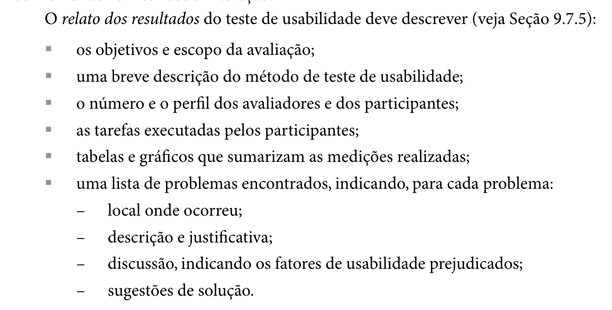

Fonte: BARBOSA; SILVA (2010, p. 343).

**Autor do item de conteúdo:** Henrique Schneider (redação assistida por Claude, IA generativa)

### 3.2. Modelo do Sumário das Medições por Tarefa

A Tabela 11 apresenta o modelo para resumir as medições de cada tarefa, com uma linha por tarefa e por protótipo.

**Tabela 11 – Modelo do sumário das medições por tarefa**

| Protótipo e tarefa | Participantes que concluíram sem ajuda | Tempo médio (desvio padrão) | Total de erros | Pedidos de ajuda | Observações |
| --- | --- | --- | --- | --- | --- |
| — | — | — | — | — | — |

Fonte: Elaborado pelos autores com base em Barbosa e Silva (2010, cap. 10, p. 342).

### 3.3. Modelo da Verificação das Metas de Usabilidade

A Tabela 12 apresenta o modelo para comparar os resultados com os valores-alvo das metas de usabilidade definidos na seção 2.8.

**Tabela 12 – Modelo da verificação das metas de usabilidade**

| Meta de usabilidade | Medida | Valor-alvo | Resultado obtido | Meta atingida? |
| --- | --- | --- | --- | --- |
| — | — | — | — | — |

Fonte: Elaborado pelos autores com base em Barbosa e Silva (2010, cap. 10, p. 342).

### 3.4. Modelo da Lista de Problemas Encontrados

A Tabela 13 apresenta o modelo da lista de problemas, com os campos indicados por Barbosa e Silva (2010, cap. 10, seção 10.2.1, p. 343) e a gravidade pela escala da Tabela 4.

**Tabela 13 – Modelo da lista de problemas do teste de usabilidade**

| ID | Local onde ocorreu | Descrição e justificativa | Discussão (fatores de usabilidade prejudicados) | Gravidade (1–4) e frequência | Sugestão de solução |
| --- | --- | --- | --- | --- | --- |
| PA01 | — | — | — | — | — |

Fonte: Elaborado pelos autores com base em Barbosa e Silva (2010, cap. 10, p. 343).

### 3.5. Cronograma do Planejamento do Relato por Integrante

Cada integrante acrescenta à Tabela 14 as tarefas e as datas do seu relato.

**Tabela 14 – Cronograma do relato dos resultados por integrante**

| Tarefa | Integrante | Início | Fim |
| --- | --- | --- | --- |
| Consolidação das medições e da lista de problemas | Henrique Schneider | 12/11/2026 | 13/11/2026 |
| Redação do relato | Henrique Schneider | 13/11/2026 | 15/11/2026 |
| Revisão cruzada | João Vitor Tavares | 14/11/2026 | 15/11/2026 |
| Publicação no GitHub Pages | Henrique Schneider | 15/11/2026 | 15/11/2026 |

Fonte: Elaborado pelos autores (2026).

## 4. Cronograma Executado

A Tabela 15 registra as atividades realmente executadas nesta entrega, com o responsável e as datas de início e fim, para comparação com o cronograma planejado na Entrega 1. Nesse cronograma, a Entrega 6 previa a execução da avaliação do protótipo de baixa fidelidade por Alexandre (27/10–28/10), a redação do relato por Camile (29/10–30/10), a construção do protótipo de alta fidelidade por Eduardo e João Vitor (31/10–01/11) e o planejamento da avaliação do protótipo de alta fidelidade por Henrique (02/11) (GRUPO 03, 2026a, seções 4.11–4.12, p. 9).

**Tabela 15 – Cronograma executado da Entrega 6**

| Atividade | Responsável | Início | Fim | Situação |
| --- | --- | --- | --- | --- |
| Construção do protótipo de papel | Henrique Schneider (protótipo de Henrique, Figuras 4 a 7) | 03/11/2026 | 03/11/2026 | Protótipo de Henrique concluído |
| Teste piloto da avaliação do protótipo de papel | Henrique Schneider | 03/11/2026, 14h00 | 03/11/2026, 14h30 | Realizado antes da Sessão 1; dados descartados (informado pelo autor em 03/11/2026); gravação: <https://youtu.be/pOa8ROlt2jw> |
| Sessões de avaliação do protótipo de papel | Henrique Schneider (Sessão 1, P5; não haverá outras sessões) | 03/11/2026 | 03/11/2026 | Sessão 1 de Henrique realizada no laboratório da UnB; T2 e T4 não executadas e sem previsão de outras sessões |
| Consolidação e relato dos resultados do protótipo de papel | Henrique Schneider (seção 1.4.1) | 03/11/2026 | Em andamento | Em andamento (parte de Henrique redigida a partir da transcrição) |
| Planejamento da avaliação do protótipo de alta fidelidade | Henrique Schneider (seções coletivas e 2.8.1); João Vitor Tavares (seção 2.8.3) | 26/10/2026 | 02/11/2026 | Parte de Henrique e de João Vitor concluída |
| Planejamento do relato do protótipo de alta fidelidade | Henrique Schneider (capítulo 3) | 26/10/2026 | 26/10/2026 | Modelos concluídos |
| Gravação do vídeo de apresentação | — | — | — | — |
| Publicação no GitHub Pages | Henrique Schneider e João Vitor Tavares (páginas individuais) | 02/11/2026 | — | Em andamento |

Fonte: Elaborado pelos autores (2026).

## 5. Conclusão

Esta entrega fecha o ciclo da prototipação de baixa fidelidade iniciado na Entrega 5 e prepara a avaliação do protótipo de alta fidelidade. O relato do Capítulo 1 registra os problemas corrigidos durante os ciclos de avaliação e reprojeto e os que ainda precisam de correção, e o planejamento dos Capítulos 2 e 3 define como o protótipo interativo será avaliado com participantes e como as metas de usabilidade da Entrega 3 serão verificadas na Entrega 7.

## Referências bibliográficas

ASSOCIAÇÃO BRASILEIRA DE NORMAS TÉCNICAS. *NBR 6023*: informação e documentação: referências: elaboração. Rio de Janeiro: ABNT, 2018.

ASSOCIAÇÃO BRASILEIRA DE NORMAS TÉCNICAS. *NBR 10520*: informação e documentação: citações em documentos: apresentação. Rio de Janeiro: ABNT, 2023.

BARBOSA, Simone Diniz Junqueira; SILVA, Bruno Santana da. *Interação humano-computador*. 1. ed. Rio de Janeiro: Elsevier, 2010.

GRUPO 03. *Relatório da Etapa 1*: planejamento do projeto. Projeto da disciplina de Interação Humano-Computador, Universidade de Brasília, 2026a. Disponível em: <https://interacao-humano-computador.github.io/2026.2-Grupo03/>.

GRUPO 03. *Metas de usabilidade*. Entrega 3 do projeto da disciplina de Interação Humano-Computador, Universidade de Brasília, 2026b. Disponível em: <https://interacao-humano-computador.github.io/2026.2-Grupo03/>.

GRUPO 03. *Relatório Entrega 5*: relato do storyboard e da HTA e planejamento do protótipo de papel. Projeto da disciplina de Interação Humano-Computador, Universidade de Brasília, 2026c. Disponível em: <https://interacao-humano-computador.github.io/2026.2-Grupo03/>.

NIELSEN, Jakob. *Usability engineering*. Boston: Academic Press, 1993. Consulta indireta por Barbosa e Silva (2010).

NIELSEN, Jakob. Heuristic evaluation. In: NIELSEN, Jakob; MACK, Robert L. (ed.). *Usability inspection methods*. New York: John Wiley & Sons, 1994. Consulta indireta por Barbosa e Silva (2010).

PREECE, Jennifer; ROGERS, Yvonne; SHARP, Helen. *Design de interação*: além da interação homem-computador. 1. ed. Porto Alegre: Bookman, 2005.

ROSA, Henrique Schneider Fernandes da. *Análise Hierárquica de Tarefas (HTA)*: agendar a prova teórica com reserva de horário. Versão 1.2. Brasília: Universidade de Brasília, 2026a.

ROSA, Henrique Schneider Fernandes da. *Especificação do protótipo de alta fidelidade*: agendamento da prova teórica com reserva de horário. Versão 1.0. Brasília: Universidade de Brasília, 2026b.

ROSA, Henrique Schneider Fernandes da. *Roteiro do teste de usabilidade*: protótipo de alta fidelidade do agendamento da prova teórica. Versão 1.0. Brasília: Universidade de Brasília, 2026c.

ROSA, Henrique Schneider Fernandes da. *Roteiro da sessão de avaliação do protótipo de papel*: agendamento da prova teórica com reserva de horário. Versão 1.1. Brasília: Universidade de Brasília, 2026d.

ROSA, Henrique Schneider Fernandes da. *Transcrição da Sessão 1 da avaliação do protótipo de papel*: agendamento da prova teórica com reserva de horário (P5), 03/11/2026. Transcrição automática (TurboScribe). Brasília: Universidade de Brasília, 2026e.

RUBIN, J. *Handbook of usability testing*. New York: John Wiley & Sons, 1994. Consulta indireta por Barbosa e Silva (2010).

RUBIN, J.; CHISNELL, D. *Handbook of usability testing*: how to plan, design, and conduct effective tests. 2. ed. Indianapolis: Wiley Publishing, 2008. Consulta indireta por Barbosa e Silva (2010).

SALES, André Barros de. *Plano de Ensino*: Interação Humano Computador (FGA0173), 02/2026, Turma 01, v1. Brasília: Universidade de Brasília, 2026.

## Agradecimentos e uso de IA generativa

### Agradecimentos

A realização desta Sexta Entrega do projeto de Interação Humano-Computador do Grupo 03 foi construída de forma colaborativa e fundamentada em referenciais teóricos da área. Registramos nossos agradecimentos:

- Orientação acadêmica: ao Prof. Dr. André Barros de Sales, pelas diretrizes e pela supervisão das atividades da disciplina de Interação Humano-Computador.
- Referencial teórico: a Simone Diniz Junqueira Barbosa e Bruno Santana da Silva, cuja obra Interação Humano-Computador (2010) embasou a prototipação em papel, o teste de usabilidade e o planejamento das avaliações; e a Jennifer Preece, Yvonne Rogers e Helen Sharp, pela fundamentação sobre prototipação de alta fidelidade e pelo framework DECIDE.
- Participantes: às pessoas que participaram voluntariamente das sessões de avaliação.
- Objeto de estudo: ao Detran-DF, cujo portal oficial é o objeto empírico deste projeto.

### Uso de inteligência artificial

Em conformidade com o Código de Conduta da Sociedade Brasileira de Computação adotado no Plano de Ensino (SALES, 2026, p. 3), declaramos o uso de ferramentas de Inteligência Artificial generativa nesta entrega. O conteúdo, as decisões metodológicas e a validação final dos artefatos são de responsabilidade do grupo.

- Claude (Anthropic): em 26/10/2026, a pedido de Henrique Schneider, utilizado para criar a estrutura deste relatório a partir do relatório da Entrega 5 e do Plano de Ensino; redigir as seções coletivas dos Capítulos 1 a 3, o Resumo, a Introdução e a Conclusão; elaborar as tabelas-modelo; propor as questões de avaliação (Tabela 7) e as medidas por tarefa de Henrique Schneider (Tabela 10); localizar e conferir no livro de Barbosa e Silva (2010) e no capítulo 8 de Preece, Rogers e Sharp (2005) os trechos citados, com capítulo, seção, página e parágrafo; e recortar as páginas usadas nas Figuras 13, 14, 16, 17, 18, 19, 21 e 23 (as demais figuras reutilizam recortes da Entrega 5). Os resultados das avaliações, as datas, os participantes e os valores-alvo não foram gerados pela ferramenta e estão marcados para preenchimento pelos integrantes. Em 27/10/2026, também a pedido de Henrique Schneider, foi usado para redigir os materiais individuais dele nesta entrega (roteiro da sessão do protótipo de papel, materiais do participante, especificação do protótipo de alta fidelidade, roteiro do teste de usabilidade e roteiro da apresentação), o guia do grupo e o texto da seção 2.8.1, e para propor os valores-alvo da Tabela 10. Em 02/11/2026, também a pedido de Henrique Schneider, foi usado para atualizar a parte dele neste relatório (Tabelas 1, 9, 10, 14 e 15 e seção 1.4.1) e publicar os materiais dele no site do grupo. Em 03/11/2026, também a pedido de Henrique Schneider, foi usado para organizar os dados da Sessão 1 do protótipo de papel de Henrique a partir da transcrição automática (TurboScribe) e do vídeo da sessão; redigir a seção 1.4.1, as linhas de Henrique nas Tabelas 1, 2, 5, 6 e 15 e as inserções das seções 1.8 e 1.9; e propor a gravidade, os fatores de usabilidade e as sugestões de correção da Tabela 5, que o grupo deve confirmar.

**Publicação no site (10/11/2026).** O Claude (Anthropic) foi utilizado, a pedido de Henrique Schneider, para transcrever a versão 1.8 do relatório do Google Docs para esta página, inserir as figuras, retirar os marcadores de preenchimento e padronizar o formato. O texto do relatório não foi reescrito. A ferramenta não é autora do artefato (SALES, 2026, p. 3).

### Ferramentas utilizadas

- Google Docs e Google Drive: redação colaborativa e controle de versões do relatório.
- GitHub e GitHub Pages: versionamento e publicação da documentação do projeto.
- Microsoft Teams: reuniões de alinhamento e gravação das sessões e apresentações.
- TurboScribe: transcrição automática do áudio da sessão do protótipo de papel de Henrique Schneider.
