# Lista de Verificação – Cenários

**Autoria:** Henrique Schneider Fernandes da Rosa · **Entrega 7** (atividade individual do Moodle, prazo 10/11/2026, 23:30)

## Tabela de contribuição

**Tabela 1 – Contribuições no trabalho "Lista de Verificação – Cenários"**

| Integrante | Contribuição | Atividade (link) | Gravação (link) |
| --- | --- | --- | --- |
| Alexandre Vilar Valadares Fonsêca | Não se aplica (atividade individual) | — | — |
| Gabriel Robson Nunes Neiva da Silva | Não se aplica (atividade individual) | — | — |
| Henrique Schneider Fernandes da Rosa | Autoria do trabalho (atividade individual) | Esta página | — |
| João Vitor Tavares de Sá Lima | Não se aplica (atividade individual) | — | — |

Fonte: elaborado pelos autores (2026).

## Histórico de versões

**Tabela 2 – Histórico de versões do trabalho "Lista de Verificação – Cenários"**

| Data | Versão | Descrição | Autor(es) | Revisor(es) |
| --- | --- | --- | --- | --- |
| 10/11/2026 | 1.0 | Elaboração do trabalho (13 itens) e publicação no site | Henrique Schneider | — |

Fonte: elaborado pelos autores (2026).

## 1. Introdução

Atividade individual do Moodle "Elaborar uma lista de verificação – Cenários", com no mínimo 8 itens (SALES, [2026]). Esta lista tem 13 itens, fundamentados em Barbosa e Silva (2010), capítulo 6, seção 6.3, conforme os slides do capítulo 6, que reproduzem páginas do livro.

Cada item é uma pergunta completa, respondida com **Conforme**, **Não conforme** ou **Não se aplica**. Abaixo de cada item estão a fonte e a foto do trecho que o fundamenta. Clique no título de cada figura para abrir a foto.

## 2. Itens da lista

### Item 1

O cenário é apresentado como uma narrativa, textual ou pictórica, concreta e rica em detalhes contextuais, de uma situação de uso da aplicação (e não como uma lista de funcionalidades ou de requisitos)?

**Fonte:** Barbosa e Silva (2010), cap. 6, seç. 6.3, slides do cap. 6, slide 9.

??? quote "Figura 1 – Foto do trecho que fundamenta o item 1"

    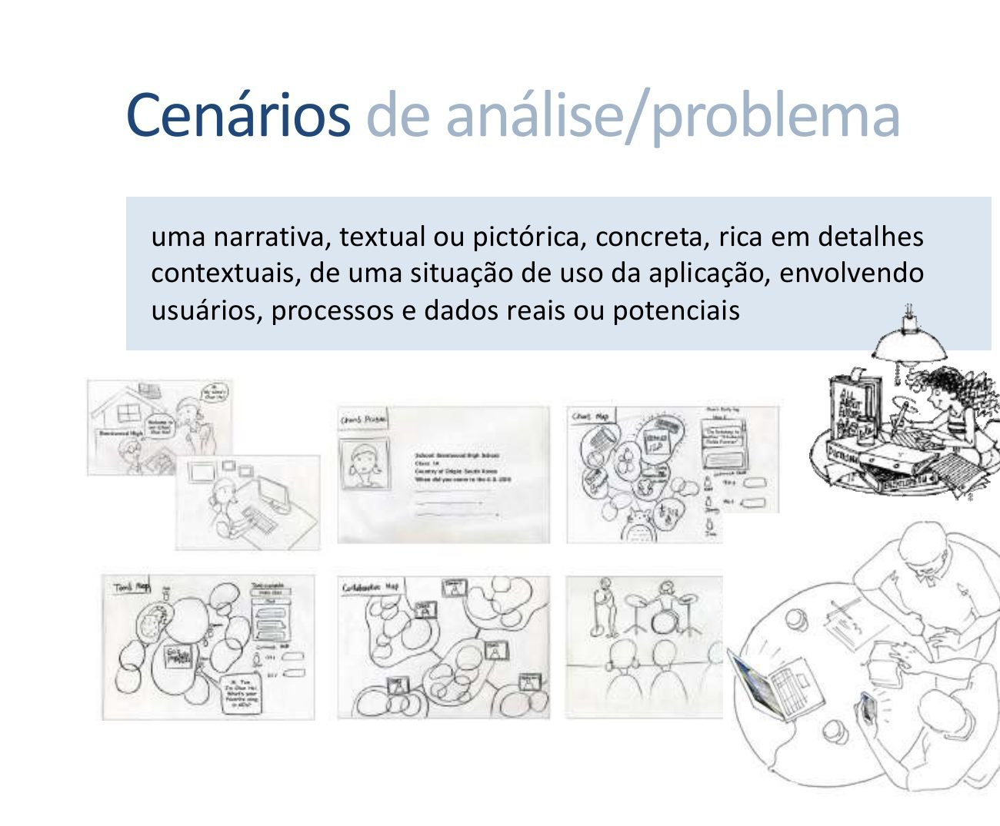

    Fonte: Barbosa e Silva (2010), cap. 6, seç. 6.3, slides do cap. 6, slide 9.

### Item 2

O cenário é uma história sobre pessoas realizando uma atividade, isto é, envolve usuários, processos e dados reais ou potenciais?

**Fonte:** Barbosa e Silva (2010), cap. 6, seç. 6.3, slides do cap. 6, slide 10, seç. 6.3.

??? quote "Figura 2 – Foto do trecho que fundamenta o item 2"

    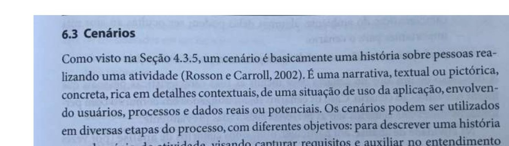

    Fonte: Barbosa e Silva (2010), cap. 6, seç. 6.3, slides do cap. 6, slide 10, seç. 6.3.

### Item 3

O artefato deixa claro para que o cenário foi elaborado: descrever uma história num domínio de atividade (para capturar requisitos e auxiliar no entendimento da atividade), levantar questões sobre a introdução de tecnologia, explorar diferentes soluções de design ou avaliar se um produto satisfaz a necessidade dos seus usuários?

**Fonte:** Barbosa e Silva (2010), cap. 6, seç. 6.3, slides do cap. 6, slide 10, seç. 6.3.

??? quote "Figura 3 – Foto do trecho que fundamenta o item 3"

    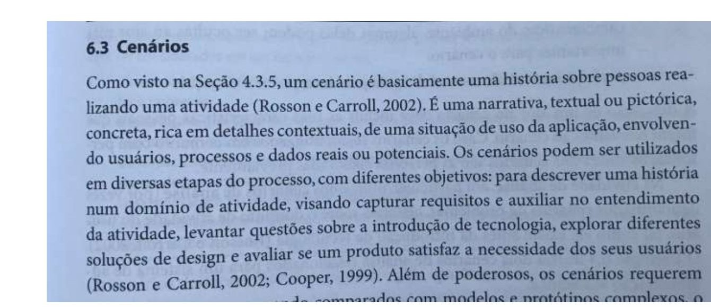

    Fonte: Barbosa e Silva (2010), cap. 6, seç. 6.3, slides do cap. 6, slide 10, seç. 6.3.

### Item 4

O cenário descreve o ambiente ou contexto, isto é, os detalhes da situação que motivam ou explicam os objetivos, as ações e as reações dos atores?

**Fonte:** Barbosa e Silva (2010), cap. 6, seç. 6.3, slides do cap. 6, slide 11.

??? quote "Figura 4 – Foto do trecho que fundamenta o item 4"

    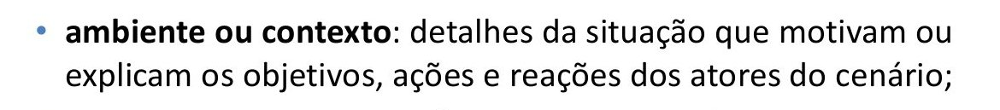

    Fonte: Barbosa e Silva (2010), cap. 6, seç. 6.3, slides do cap. 6, slide 11.

### Item 5

O cenário identifica os atores, isto é, as pessoas que interagem com o computador ou com outros elementos do ambiente, com as características pessoais relevantes ao cenário?

**Fonte:** Barbosa e Silva (2010), cap. 6, seç. 6.3, slides do cap. 6, slide 11.

??? quote "Figura 5 – Foto do trecho que fundamenta o item 5"

    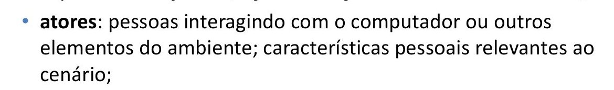

    Fonte: Barbosa e Silva (2010), cap. 6, seç. 6.3, slides do cap. 6, slide 11.

### Item 6

O cenário declara os objetivos dos atores, isto é, os efeitos desejados na situação que motivam as ações realizadas por eles?

**Fonte:** Barbosa e Silva (2010), cap. 6, seç. 6.3, slides do cap. 6, slide 11.

??? quote "Figura 6 – Foto do trecho que fundamenta o item 6"

    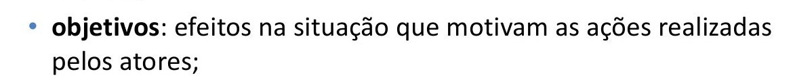

    Fonte: Barbosa e Silva (2010), cap. 6, seç. 6.3, slides do cap. 6, slide 11.

### Item 7

O cenário registra o planejamento, isto é, a atividade mental dirigida para transformar um objetivo em um comportamento ou conjunto de ações?

**Fonte:** Barbosa e Silva (2010), cap. 6, seç. 6.3, slides do cap. 6, slide 11.

??? quote "Figura 7 – Foto do trecho que fundamenta o item 7"

    

    Fonte: Barbosa e Silva (2010), cap. 6, seç. 6.3, slides do cap. 6, slide 11.

### Item 8

O cenário descreve as ações (comportamento observável dos atores) e os eventos (ações externas ou reações produzidas pelo computador ou por outras características do ambiente)?

**Fonte:** Barbosa e Silva (2010), cap. 6, seç. 6.3, slides do cap. 6, slide 11.

??? quote "Figura 8 – Foto do trecho que fundamenta o item 8"

    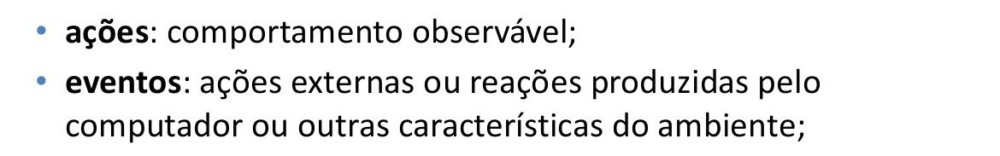

    Fonte: Barbosa e Silva (2010), cap. 6, seç. 6.3, slides do cap. 6, slide 11.

### Item 9

O cenário registra a avaliação, isto é, a atividade mental dirigida para interpretar a situação?

**Fonte:** Barbosa e Silva (2010), cap. 6, seç. 6.3, slides do cap. 6, slide 11.

??? quote "Figura 9 – Foto do trecho que fundamenta o item 9"

    

    Fonte: Barbosa e Silva (2010), cap. 6, seç. 6.3, slides do cap. 6, slide 11.

### Item 10

Depois da narrativa, há uma análise do cenário que lista os pontos que podem ser considerados problemáticos e que devem ser considerados em um reprojeto de IHC (por exemplo, transcrição manual de dados, falta de integração com outras informações, impossibilidade de realizar uma ação pelo próprio sistema)?

**Fonte:** Barbosa e Silva (2010), cap. 6, seç. 6.3, slides do cap. 6, slide 13, slide com a “Análise dos cenários”.

??? quote "Figura 10 – Foto do trecho que fundamenta o item 10"

    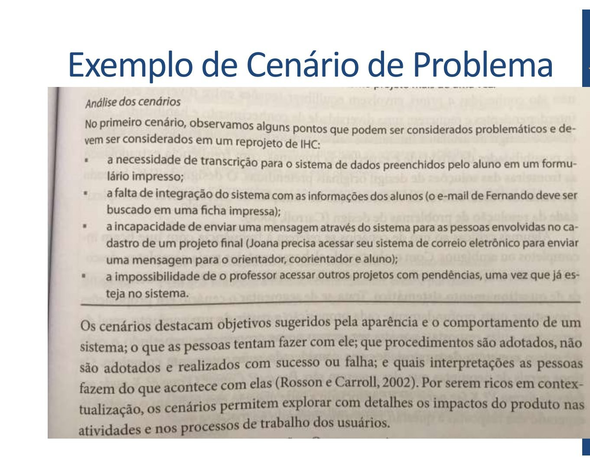

    Fonte: Barbosa e Silva (2010), cap. 6, seç. 6.3, slides do cap. 6, slide 13, slide com a “Análise dos cenários”.

### Item 11

O cenário foi refinado pelo questionamento sistemático (Carroll et al., 1994), segmentando-o em proposições e fazendo as perguntas “Por quê?”, “Como?” e “O que é?”, cujas respostas trazem, respectivamente, as condições, as consequências e os estados anteriores ou posteriores da atividade; os detalhes da sequência de ações; e os objetos e seus atributos?

**Fonte:** Barbosa e Silva (2010), cap. 6, seç. 6.3, slides do cap. 6, slide 14, Tabela 6.1.

??? quote "Figura 11 – Foto do trecho que fundamenta o item 11"

    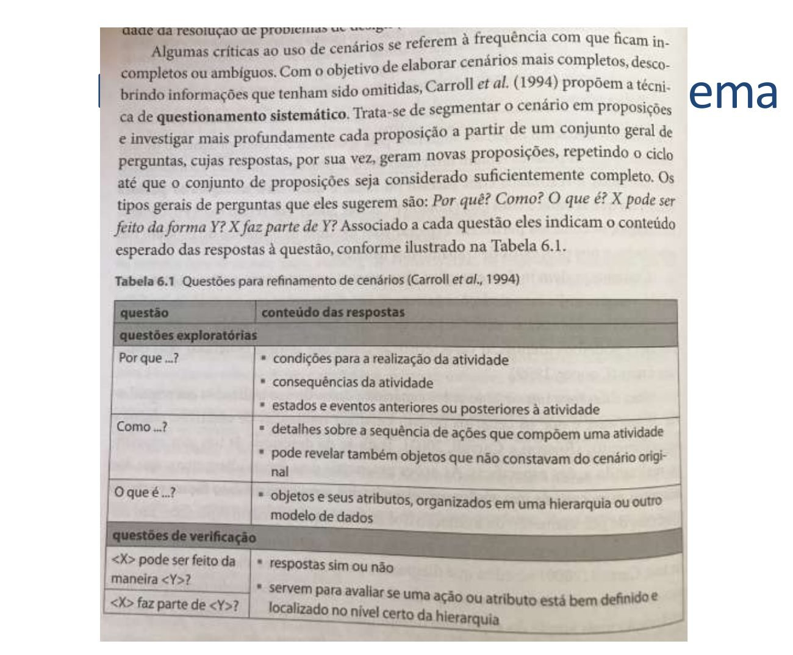

    Fonte: Barbosa e Silva (2010), cap. 6, seç. 6.3, slides do cap. 6, slide 14, Tabela 6.1.

### Item 12

O cenário foi verificado com perguntas de resposta sim ou não — “<X> pode ser feito da maneira <Y>?” e “<X> faz parte de <Y>?” — para avaliar se uma ação ou atributo está bem definido e localizado no nível certo da hierarquia?

**Fonte:** Barbosa e Silva (2010), cap. 6, seç. 6.3, slides do cap. 6, slide 14, Tabela 6.1.

??? quote "Figura 12 – Foto do trecho que fundamenta o item 12"

    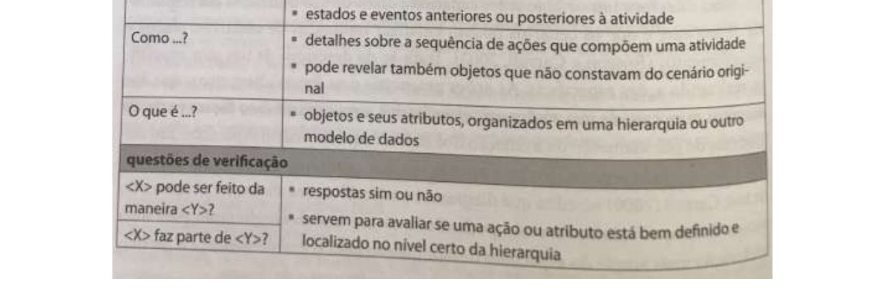

    Fonte: Barbosa e Silva (2010), cap. 6, seç. 6.3, slides do cap. 6, slide 14, Tabela 6.1.

### Item 13

Para cada elemento do cenário (objetivo, ambiente, atores e planejamento) foram feitas as perguntas da Tabela 6.2 (por exemplo, para o objetivo: por que os atores querem ou precisam alcançá-lo e quais as precondições; para o ambiente: em que situações o cenário ocorre, quando, onde e por quê)?

**Fonte:** Barbosa e Silva (2010), cap. 6, seç. 6.3, slides do cap. 6, slide 15, Tabela 6.2.

??? quote "Figura 13 – Foto do trecho que fundamenta o item 13"

    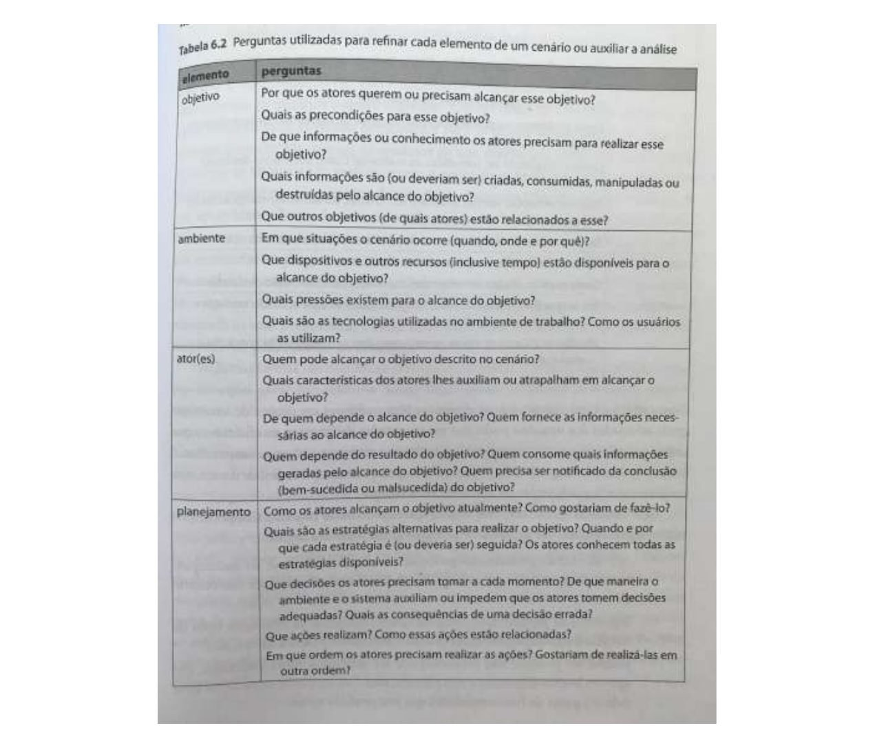

    Fonte: Barbosa e Silva (2010), cap. 6, seç. 6.3, slides do cap. 6, slide 15, Tabela 6.2.

## Referências bibliográficas

BARBOSA, Simone Diniz Junqueira; SILVA, Bruno Santana da. *Interação Humano-Computador*. Rio de Janeiro: Elsevier, 2010.

SALES, André Barros de. *Plano de Ensino: Interação Humano Computador (FGA0173), 02/2026, Turma 01, v1*. Brasília: Universidade de Brasília, 2026.

## Agradecimentos e uso de IA generativa

**Uso de IA generativa neste trabalho.** O Claude (Anthropic) foi utilizado, a pedido de Henrique Schneider, para localizar nos slides do capítulo 6 os trechos sobre cenários, redigir a primeira versão dos itens como perguntas completas, recortar as imagens dos slides e formatar o documento e esta página. O conteúdo foi conferido pelo autor com os slides, e a ferramenta não é autora do trabalho (SALES, 2026, p. 3).
